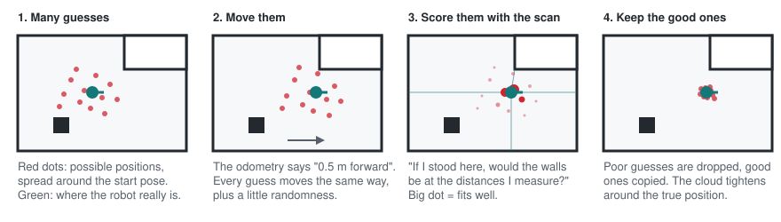
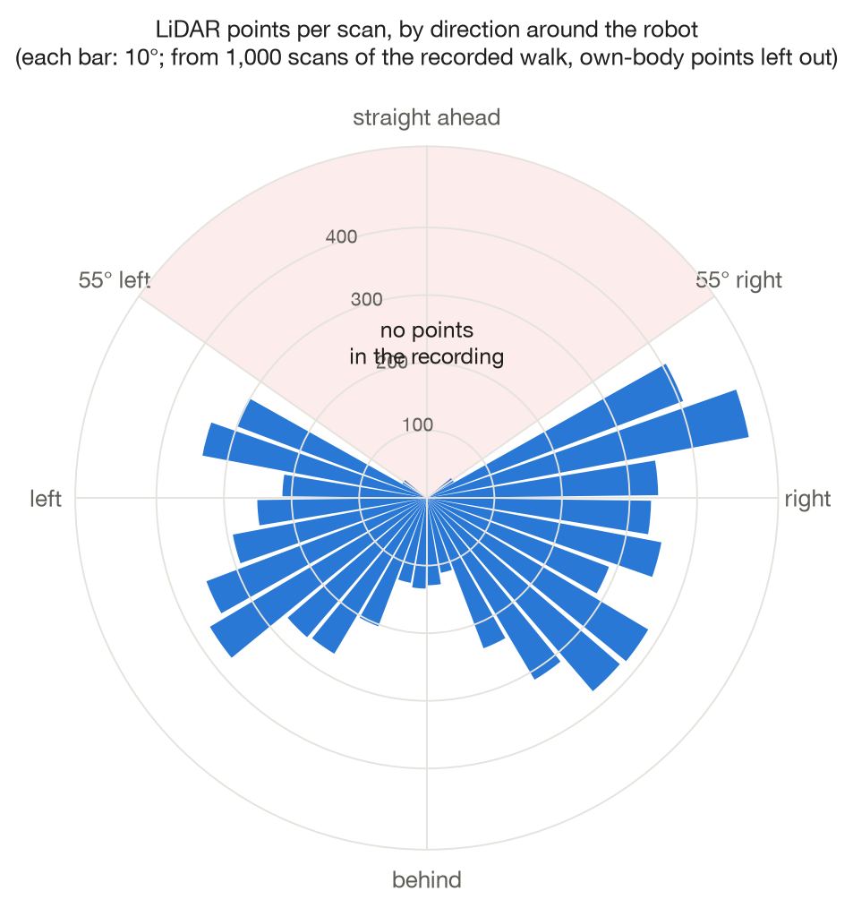

[Back to all setups](index.html)

# Localisation with AMCL: how the robot finds itself on a map

This page explains **AMCL**, the localiser that comes with Nav2, and documents how we set it up for a
**Unitree G1** in a simulated copy of our hall. It is written for someone who has never used it.

Last updated: 18 November 2026.

**Status: simulation only.** Nothing on this page has run on the real robot yet. The first tests used a
perfect laser; the later ones use the scan pattern of the robot's real LiDAR, which changes the answer.
See [The catch on our robot](#the-catch-on-our-robot) and the section after it.

New to odometry, localisation or TF? Read the [basics page](basics.html) first.

---

## What is AMCL?

AMCL answers one question: **where is the robot on a map it already has?**

It does not build the map and it does not plan a path. It takes a stored map, the robot's laser scan and
the robot's odometry, and gives back a position and a heading. The name stands for *Adaptive Monte
Carlo Localization*. "Monte Carlo" means it works with many random guesses instead of one calculation.

### The building blocks

| Word | What it is | Here |
|---|---|---|
| **Map** | A floor plan as a grid of cells: occupied, free or unknown | 5 cm cells, made from a LiDAR walk through the hall |
| **Scan** | One ring of distances around the robot, measured by the laser | 720 directions, 10 times a second |
| **Odometry** | The robot's own estimate of how far it has moved. Smooth, but it drifts | From the LiDAR and motion sensor |
| **Particle** | One guess of where the robot is: a position and a heading | 500 to 3,000 at a time |
| **Weight** | How well a particle's guess fits the current scan | Recomputed with every update |
| **Resampling** | Dropping particles with a low weight and copying those with a high one | After every update |
| **Initial pose** | Where you tell AMCL the robot starts. The first particles are spread around it | A marked start spot |
| **`map → odom`** | AMCL's answer in ROS: the correction that turns the drifting odometry into a position on the map | Published as a TF transform |

---

## How it works, step by step



1. **Start with many guesses.** AMCL places some hundred particles around the start pose you gave it.
   Each one says "maybe the robot is here, facing this way".
2. **Move the guesses with the robot.** When the odometry reports that the robot walked half a metre
   forward and turned a little, every particle is moved the same way. A bit of randomness is added,
   because odometry is never exact. This is what keeps some particles close to the truth even when the
   odometry is a little wrong.
3. **Score each guess with the scan.** For every particle AMCL asks: if the robot stood here, would the
   walls on the map be at the distances the laser measures right now? A particle whose walls line up
   gets a high weight. One where the laser "sees" a wall in the middle of free space gets a low one.
4. **Keep the good guesses.** Particles with a low weight are dropped, those with a high weight are
   copied. After a few rounds the cloud of particles sits tightly around the true position.

The position AMCL reports is the middle of that cloud. It repeats steps 2 to 4 every time the robot has
moved a set distance, here 10 cm or about 6°.

"Adaptive" only means that AMCL uses fewer particles when the cloud is tight and more when it is wide,
to save computing time.

### What it hands to Nav2

AMCL does not replace the odometry. It publishes the **correction** between the two:

```
map → odom          from AMCL, changes slowly, a few times a second
odom → base_link    from the odometry, smooth, 50 times a second
```

Nav2 chains the two to get the robot's position on the map. If AMCL stops for a moment, the robot still
has a smooth position from the odometry, only without new corrections.

---

## What AMCL needs

| Input | Why | What goes wrong without it |
|---|---|---|
| A map that matches what the laser sees | Step 3 compares the scan with the map | The scan fits a wrong place better than the right one, and the position drifts off |
| A scan | The only evidence about the real position | No corrections; the position is the odometry alone |
| Odometry | Moves the particles between scans | Particles stay behind while the robot walks |
| A rough start pose | The first particles have to be near the truth | AMCL settles on a wrong place and does not notice |

---

## Two ways to feed it

The program is the same in both. The difference is **which scan** and **which map** it gets.

| | Textbook | Slice above head height |
|---|---|---|
| Scan | The normal scan at body height, the same one Nav2 uses to avoid obstacles | One ring of distances at a height above people and furniture (2 m in our simulation) |
| Map | The normal map | A second map of what exists at that height |
| What the scan contains | Walls, columns, tables, chairs, people | Walls, columns and tall cabinets only |
| Strong point | More detail to match, so a little more precise | Nothing at that height moves, so the scan always fits the map |
| Weak point | Breaks when furniture is moved and the map is not updated | Needs a sensor that actually sees that height, and enough wall up there |

Nav2 keeps using the normal body-height scan for avoiding obstacles in both cases. The slice is only for
finding the position.

### The two-map trick

For the slice, AMCL needs its own map while the rest of Nav2 keeps the normal one. Run a second map
server that publishes on another topic, and point AMCL at it:

```python
# launch file (Python), shortened
Node(package="nav2_map_server", executable="map_server", name="map_server",
     parameters=[{"yaml_filename": "hall_map.yaml"}]),                       # for the costmaps, topic /map
Node(package="nav2_map_server", executable="map_server", name="map_server_high",
     parameters=[{"yaml_filename": "hall_map_high.yaml",
                  "topic_name": "map_amcl", "frame_id": "map"}]),            # for AMCL only
Node(package="nav2_amcl", executable="amcl", name="amcl",
     parameters=[{"scan_topic": "scan_high", "map_topic": "map_amcl", ...}]),
Node(package="nav2_lifecycle_manager", executable="lifecycle_manager",
     name="lifecycle_manager_localization",
     parameters=[{"autostart": True, "node_names": ["map_server", "map_server_high", "amcl"]}]),
```

Both maps must use the same origin and cell size, so that a position means the same thing on both.

---

## The settings we used

ROS 2 Humble, package `nav2_amcl`. Everything not listed is at its default.

```yaml
amcl:
  ros__parameters:
    use_sim_time: true                 # false on a real robot
    global_frame_id: map
    odom_frame_id: odom
    base_frame_id: base_link
    robot_model_type: "nav2_amcl::OmniMotionModel"   # the robot can also step sideways
    alpha1: 0.2                        # how much the odometry is distrusted (alpha1 to alpha5)
    alpha2: 0.2
    alpha3: 0.2
    alpha4: 0.2
    alpha5: 0.2
    laser_model_type: likelihood_field
    laser_likelihood_max_dist: 2.0
    laser_max_range: 15.0
    max_beams: 120                     # of the 720 directions, 120 are used per update
    min_particles: 500
    max_particles: 3000
    update_min_d: 0.10                 # update after 10 cm of walking ...
    update_min_a: 0.10                 # ... or 0.1 rad (about 6 degrees) of turning
    resample_interval: 1
    z_hit: 0.5
    z_rand: 0.5
    sigma_hit: 0.2
    transform_tolerance: 0.5
    tf_broadcast: true                 # AMCL publishes map -> odom
    scan_topic: scan_high              # "scan" for the textbook set-up
    map_topic: map_amcl                # "map" for the textbook set-up
    set_initial_pose: true             # start pose from the parameters below
    initial_pose: {x: 0.0, y: 0.0, z: 0.0, yaw: 0.0}   # put the marked start spot here
```

Remove the static `map → odom` transform if your launch file had one for testing. AMCL publishes that
transform now, and two publishers for the same transform make the position jump.

---

## What a simulation with a perfect laser told us

All of this is from a simulated hall with a **perfect** laser: no noise, no glass, no swaying head. Treat
the numbers as a best case. The odometry was made to drift on purpose (3 % too far, 3 % too much turning,
plus 0.1° per second), which is far worse than what our LiDAR odometry showed on a real walk.

* **Without a localiser** the robot was several metres off after ten minutes and still reported its goals
  as reached. Obstacle avoidance kept working, because that uses the live scan and not the position.
* **Both set-ups** held the position in the unchanged hall, and also with people walking around: about
  5 cm typically for the textbook set-up and about 10 cm for the slice, 25 cm at worst for both.
* **With furniture that was not on the map**, the textbook set-up lost the position by several metres
  within a minute and did not recover. The slice above head height stayed at about 10 cm.
* **A wrong start pose** of about 1 m and 30° was corrected within half a minute of walking.
* **10 to 20 cm of error is not nothing.** With a robot outline that leaves only a few centimetres of room,
  the robot touched things it would have missed with an exact position. Leave more room than the outline
  once the position comes from a localiser.

---

## The catch on our robot

The slice above head height was tested with a laser ring that sits at 2 m and looks out level. **Our robot
does not have that.** Measured from a recorded walk of the real robot:

* The G1's LiDAR sits in the head, between 1.2 and 1.3 m above the floor, **upside down** and tilted about
  10° nose-down. Its wide side looks at the floor.
* Upwards it reaches about 6° above level towards the front and about 18° towards the back. So it sees
  walls at 2 m height only from a few metres away, and mostly behind the robot.
* **A gap straight ahead.** The recording holds no points within about 55° to either side of the walking
  direction. Whether the head covers the sensor there or the driver cuts that sector out is not checked
  yet. Either way, a flat scan made from this cloud is empty straight ahead.
* **What that did in simulation:** obstacle avoidance fed with this scan still avoided furniture, which it
  sees from the side before the robot turns towards it. It walked into people who stood straight ahead,
  in each of three runs. A scan with such a gap needs a second sensor for the front. How the depth camera
  in the head is added is on its own page: [A depth camera for the front](front-camera.html).



So the recipe above does not carry over as it is. The idea does: **match only against things that never
move.**

---

## The same tests with the robot's real scan pattern

We then replaced the perfect laser with the real one. The simulator casts the laser directions of the
real recording, scan after scan, from the real mounting, with 2 cm of range noise. Four ways to localise
were compared: in the unchanged hall, with six people walking around, and twice with furniture that is
not on the map. The odometry drifts as before.

| Way | Unchanged hall | With people | Furniture not on the map |
|---|---|---|---|
| AMCL on a flat scan at body height (points from 0.1 to 1.5 m), normal map | 11 cm, worst 30 cm | 14 cm, worst 31 cm | **lost by about 4 m**, in both runs |
| The same with beam skipping | 5 cm, worst 16 cm | 5 cm, worst 16 cm | **lost by 2 to 3 m**, in both runs |
| AMCL on far walls only (points from 1.8 to 2.3 m, map of that height) | 19 cm, worst 36 cm | 19 cm, worst 44 cm | 23 cm, worst 46 cm |
| 3D scan matching: the whole cloud against a 3D map (this is not AMCL) | under 1 cm | under 1 cm | under 1 cm, worst 6 cm |

The numbers are the typical (median) and the worst position error over a tour of three to ten minutes.

* **AMCL at body height is fine as long as the room matches the map.** People walking around did not
  disturb it. Furniture that is not on the map did: the position was lost within a minute and never came
  back.
* **Beam skipping halves the error but does not save it.** With rows of unknown furniture too many
  readings are wrong at once.
* **The far-wall slice is the only AMCL set-up that survived moved furniture.** It is coarse, because
  only a few points of each scan lie that high: plan for half a metre of error, not 10 cm.
* **3D scan matching was far more precise in every case.** It compares the whole 3D scan with a 3D map,
  so walls and columns outvote the furniture. Read its numbers as a best case: the 3D map
  came from the simulator's own geometry, and the simulated head does not sway. It also only follows a
  position it already has (it needs a start within a few tens of centimetres of the truth); it does not
  search.

A flat scan is cut from the 3D cloud by keeping the points in a height band and taking the closest one per
direction. On a robot the `pointcloud_to_laserscan` package does this (`min_height`, `max_height`); in
the simulation we cut the band ourselves.

Beam skipping lets AMCL ignore beams that most particles disagree with. It is switched on like this; the
three numbers are Nav2's defaults:

```yaml
amcl:
  ros__parameters:
    laser_model_type: likelihood_field_prob   # beam skipping only works with this model
    do_beamskip: true
    beam_skip_distance: 0.5          # largest distance (m) to consider skipping for; the default
    beam_skip_threshold: 0.3         # "percentage of beams required to skip" in Nav2's words; the default
    beam_skip_error_threshold: 0.9   # when this share of beams does not match the map, all beams are used again; the default
```

**Where this leaves us.** In a hall where furniture moves, AMCL on the normal scan is not safe. The
far-wall slice is the AMCL set-up to start with on this robot, with wide margins. 3D scan matching is the
stronger candidate and the next thing to try with real data.

---

## When the furniture moves: keeping the map current

A hall that is rearranged for every event breaks the rule AMCL lives by: the room must match the map.
There are two ways out. Either the map is made again after each rearrangement, or the robot localises on
something that never moves.

### Does a fresh map fix AMCL?

We tested this in simulation. The robot walked a tour of seven goals through a rearranged hall, once with
the old map from before the furniture moved and once with a fresh map. The fresh map came from a
simulated mapping round with a LiDAR 0.40 m above the floor, as a robot dog would carry it. Each case ran
twice, once with furniture as solid blocks and once as tops on thin legs.

| Localiser | Old map: goals reached | Old map: position error | Fresh map: goals reached | Fresh map: position error |
|---|---|---|---|---|
| AMCL on a flat scan at body height | **0 of 14** | about 2 m, worst 3.3 m | 14 of 14 | 7 cm, worst 19 cm |
| 3D scan matching | 13 of 14 | under 1 cm, worst 6 cm | 13 of 14 | under 1 cm, worst 2 cm |

* **A fresh map fixes AMCL completely.** With the old map it is lost for about 90 % of the walk; with the
  fresh one it is as good as in a hall that never changed.
* **It does not matter much who makes the map.** A map from dog height worked for a robot that scans from
  head height. A mapping walk with the humanoid itself gives the same kind of map and needs no second
  robot.
* **3D scan matching does not need the fresh map.** It matches against walls and columns up to 3 m high,
  and those stay where they are. It missed one goal per map with the position still right to within 3 cm: once a
  hand was caught on a thin column, the other miss we did not look into.

Read this with care: one walk per case, simulation only, and the mapping round knew its own position
exactly. A real mapping robot has to localise itself while it maps, and its errors end up in the map.

### The plan we follow

1. **One permanent map of what never moves.** Walls and columns only, taken from the mapping walks we
   already have. As a 3D map for the scan matcher and as a 2D map for Nav2's planner.
2. **Localise with 3D scan matching, from a marked start spot.** The matcher follows a position, it does
   not search for one, so the robot starts every session from the same mark on the floor.
3. **Furniture is never on the stored map.** The robot sees it live: the LiDAR all around, and a
   [forward camera](front-camera.html) for the sector straight ahead that the LiDAR misses. Nav2 adds
   what they see to its costmaps while walking.
4. **Fallback: a short mapping walk before the event.** If the matcher does not hold up on the real
   robot, the humanoid is steered once around the hall after the last table is placed, the recording is
   turned into a new map, and plain AMCL runs on that. With the forward camera the walk covers the sector
   ahead as well.
5. **No second robot.** The mapping round with a dog works in simulation, but the humanoid can do the same
   round itself.

Why the stored map should hold fixed structure only: Nav2 can add obstacles it sees, but it does not
remove furniture that is drawn on the stored map and no longer there. An old furnished map leaves ghost
tables in the planner, and goals on them are refused.

Still open: the permanent map has to be made and tried against a real recording, and the forward camera
has only been used for avoiding obstacles so far, not for making the map.

---

## Gotchas

| Problem | Cause | Fix |
|---|---|---|
| Position jumps back and forth | Two publishers of `map → odom` (AMCL and a leftover static transform) | Remove the static transform |
| Nav2 waits forever at start-up | AMCL has no start pose, so it publishes no transform | `set_initial_pose: true` with a pose, or send one on `/initialpose` |
| Position drifts off in a furnished room | The scan sees furniture that is not on the map | Update the map, or match only against fixed structure |
| Position is fine but the robot still touches things | The outline leaves less room than the localiser's error | Add at least the worst error as margin |
| AMCL never updates | The scan's topic name or frame does not match what AMCL expects | Check `scan_topic`, and that the scan's frame exists in TF |
| The robot believes it reached a goal it did not reach | Goals are judged by the estimated position | When testing in simulation, check against the true position as well |
| The robot walks into something straight ahead | The scan has no readings in that direction, so neither Nav2 nor a stop zone can see it | Check what your scan really covers all around; add a [forward camera](front-camera.html) to obstacle avoidance |
| Works in one room, not in a long plain corridor | Along a plain wall every place looks the same to the scan | Keep corners or columns in view; this is a limit of the method |

---

## Further reading

* Nav2's own description of the package and all parameters: [docs.nav2.org, AMCL](https://docs.nav2.org/rolling/configuration_and_development/configuration_guide/others/configuring_amcl/)
* How other people localise robots indoors: the localisation part of the [research page](https://wookkim1031.github.io/robot-navigation-research/#localisation)
