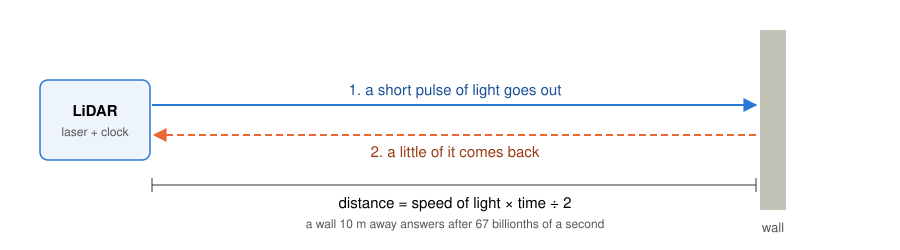
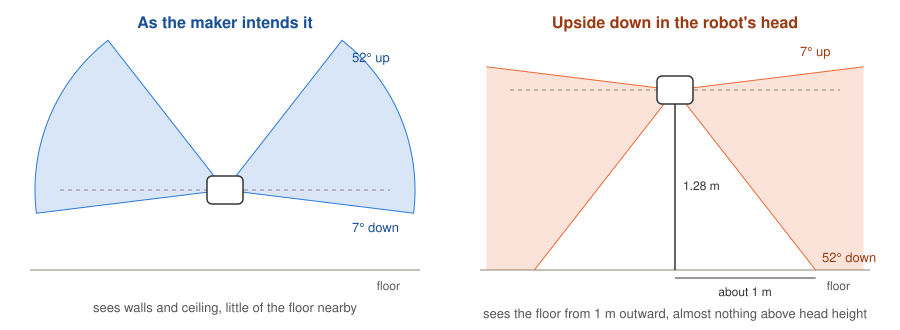
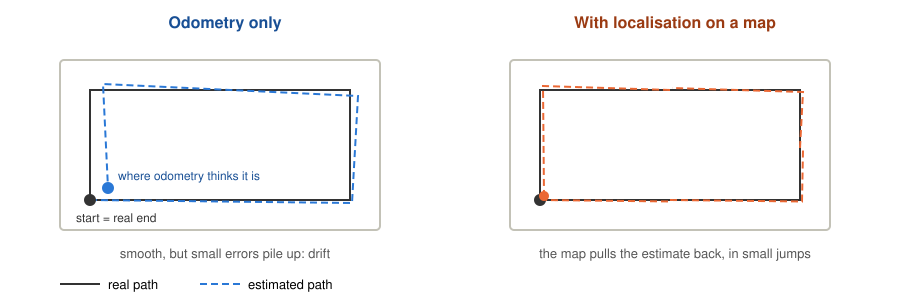
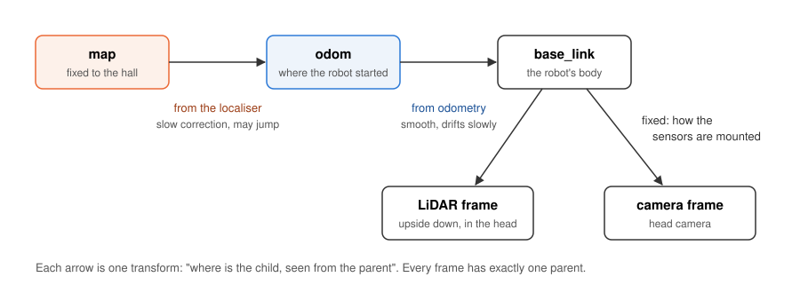

[Back to all setups](index.html)

# Basics: LiDAR, IMU, odometry, localisation and TF

This page explains the ideas behind the [navigation](navigation.html) and [digital twin](digital-twin.html)
pages, from the sensor up. It is meant to be read once from top to bottom. Each part ends with what it
looks like on our robot, a **Unitree G1** with a **Livox Mid-360** LiDAR in its head.

The five parts build on each other:

| Part | Question it answers |
|---|---|
| [1. LiDAR](#1-lidar) | How does the robot measure the room? |
| [2. IMU](#2-imu) | How does it feel its own motion? |
| [3. Odometry](#3-odometry) | How far has it moved since it started? |
| [4. Localisation](#4-localisation) | Where is it on the map? |
| [5. TF](#5-tf-how-ros-keeps-track-of-frames) | How do all programs agree on "where"? |

---

## 1. LiDAR

### How it measures

A LiDAR sends out a very short pulse of laser light and measures how long it takes to come back. Light
travels at a known speed, so the time gives the distance. This is called **time of flight**.



The times are tiny: a wall 10 m away answers after 67 nanoseconds. A difference of 1 cm in distance is a
difference of 67 picoseconds. Building a clock that fine is most of what makes a LiDAR hard to build.

One pulse gives one distance in one direction, so one **point**. To see a room, the LiDAR has to send
pulses in many directions, very fast. The Mid-360 sends 200,000 per second.

### The kinds of LiDAR

LiDARs differ in two things: how they point the beam, and how they measure the time.

**How the beam is pointed**

| Kind | How it works | Typical use |
|---|---|---|
| **2D spinning** | One beam on a spinning mirror: a flat slice of the room | Vacuum robots, warehouse robots |
| **3D mechanical spinning** | Many lasers stacked above each other (16, 32, 64 ...), the whole head spins | Self-driving cars of the first generation; gives neat horizontal rings |
| **Rotating prisms or mirrors ("hybrid solid-state")** | The lasers stand still; small spinning optics steer the beam in a pattern that fills in over time | **Livox sensors, including ours** |
| **MEMS mirror** | A tiny mirror on a chip tilts back and forth | Car sensors looking forward |
| **Flash** | No moving parts: one flash lights the whole scene, a camera-like chip times every pixel | Short range, phones, docking |

**How the time is measured**

| Kind | How it works | Note |
|---|---|---|
| **Pulsed (direct time of flight)** | Time one short pulse | Most robot LiDARs, including ours |
| **Phase shift** | Send light that brightens and dims in a rhythm, and compare the rhythm of what comes back | Precise at short range; indoor scanners and depth cameras |
| **FMCW** | Send light whose colour sweeps, and compare with what comes back | Also measures how fast the target moves; newer and more expensive |

Two more words you will meet:

* **Wavelength.** Most LiDARs use 905 nm (ours) or 1550 nm infrared light. Both are invisible. At
  1550 nm more power is allowed while staying safe for eyes, which gives more range, at a higher price.
* **Repetitive or not.** A spinning LiDAR draws the same rings every turn, with gaps between the rings
  that never get filled. A prism LiDAR like ours draws a pattern that does not repeat, so the longer it
  looks at a still scene, the more of it gets covered.

A **depth camera**, like the RealSense in the G1's head, is not a LiDAR. It has two infrared cameras and
works out depth from the difference between their pictures, like our two eyes. It gives a dense picture
at short range (a few metres); a LiDAR gives sparser points, all around, at long range.

### What comes out: the point cloud

The LiDAR collects points for a tenth of a second and sends them as one **frame**, also called a scan
or a cloud. Ten frames per second. Each point has:

| Field | Meaning |
|---|---|
| `x`, `y`, `z` | Where the point is, in metres, seen from the sensor |
| `intensity` | How much light came back: bright and dark surfaces differ |
| `time` | When within the frame this point was measured |

The `time` field matters more than it looks. The points of one frame are **not** measured at the same
instant. If the sensor moves during that tenth of a second, the frame is smeared. Turning the head at a
gentle 0.5 radians per second rotates it by about 3° within one frame, and 3° is half a metre at a wall
10 m away. Correcting this, using the motion sensor and the time of every point, is called **deskewing**.
Without it a map made while moving comes out with doubled walls.

### Our sensor in numbers

From the maker's [data sheet](https://www.livoxtech.com/mid-360/specs):

| Property | Value |
|---|---|
| Light | 905 nm, eye-safe (Class 1) |
| Points | 200,000 per second, 10 frames per second |
| Field of view | 360° around, from 7° below to 52° above its own horizon |
| Range | 40 m on dark surfaces (10 % reflective), 70 m on bright ones (80 %) |
| Closest distance | 0.1 m |
| Precision | 2 cm or better at 10 m, and better than 0.15° in direction |
| Motion sensor | Built in (see part 2) |
| Size and weight | 65 × 65 × 60 mm, 265 g |

### What it looks like on our robot



* **It is mounted upside down.** Its wide side, meant to look up at walls and ceiling, looks down at the
  floor. From a head height of 1.28 m, the steepest beams reach the floor about 1 m from the robot.
* **Fewer than half the pulses come back.** Of 20,000 pulses per frame, about 8,300 returned in our
  hall (41 %). The rest hit nothing in range, or something that swallowed or deflected the light.
* **Where the points land:** about 41 % on the floor, 44 % on things between floor and head height, and
  only 15 % above head height.
* **The robot sees itself.** About 15 % of the points are closer than 1.1 m, which is the robot's own
  body. Software has to cut these away (a "crop box") or the robot becomes part of its own map.
* **A blind sector.** There are almost no points within 50° to either side of one direction. If that is
  the walking direction, the robot does not see what is straight ahead. This still has to be checked
  on the robot.

### What LiDAR cannot do

| Problem | Why |
|---|---|
| **Glass** | Light goes through or reflects away. Glass walls are invisible or produce ghost points behind them |
| **Mirrors and shiny floors** | The sensor sees the reflected room as if it were real |
| **Black, matt surfaces** | Too little light comes back; the range drops |
| **Very close objects** | Nothing closer than 10 cm |
| **Meaning** | A LiDAR gives shape, not what the thing is. A chair and a box of the same size look alike |

---

## 2. IMU

### What it measures

An IMU (inertial measurement unit) is a small chip that feels motion. Phones have one. It contains:

| Part | Measures | Unit |
|---|---|---|
| **Gyroscope** | How fast the sensor turns, around three axes | radians per second |
| **Accelerometer** | How strongly the sensor is pushed, along three axes | metres per second squared, or g |

It measures 200 times per second on our robot, twenty times faster than the LiDAR produces frames.
That speed is its job: it fills the gaps between LiDAR frames.

### The surprising part: an accelerometer at rest does not read zero

An accelerometer lying on a table reads **1 g, pointing up**. It feels the table pushing against
gravity. This is useful: at rest, the direction of that 1 g tells the sensor which way is up. It gives
tilt for free, but not heading, because turning around the vertical does not change it.

On our robot, the sensor at rest reads about (−0.18, 0.06, −0.98) g. The large value is on the z axis
and it is **negative**: the sensor's own "up" points at the floor. That is how the data itself shows that
the LiDAR is upside down, tilted by about 11°.

### Why an IMU alone is not enough

In principle the IMU gives everything: add up the turning to get the orientation, add up the
acceleration to get the speed, add up the speed to get the position. In practice every reading has a
small constant error, the **bias**, and adding it up makes it grow:

* A bias of only 0.01 m/s² (one thousandth of gravity) becomes 18 m of position error after one minute.
* Our own example: with the wrong setting for the upside-down sensor, the software took gravity for
  motion and reported 20 km travelled after 150 seconds, while the robot was walking slowly through the hall.

So an IMU is excellent for a fraction of a second and useless over minutes. It needs a partner that
sees the outside world. That partner is the LiDAR.

### Three practical things

* **Calibration at rest.** Software estimates the bias while the robot stands still at the start (three
  seconds in our setup). This is why every recording starts with the robot standing still.
* **Time stamps.** IMU readings are only useful if their times are exact. On our robot they arrive in
  bursts, several at almost the same moment, and have to be spread evenly again.
* **Six axes, not nine.** Ours has a gyroscope and an accelerometer. Some IMUs add a compass. Indoors,
  near steel and motors, a compass is unreliable, so nobody misses it.

---

## 3. Odometry

### What it is

**Odometry** is the robot's running estimate of how it has moved since it was switched on: position and
orientation, updated many times per second. It has no map and no idea where the door is. It only knows
"I am 3.2 m ahead and 1.1 m to the left of where I started, facing 40° to the left".

### Where it can come from

| Source | How | Weakness |
|---|---|---|
| **Wheels** | Count wheel turns | Wheels slip; a humanoid has none |
| **Legs** | Joint angles plus which foot is on the ground | Feet slip and roll; drifts quickly |
| **Camera** (visual odometry) | Follow image details from frame to frame | Blur, dark rooms, blank walls |
| **LiDAR** | Line up each new scan with the previous ones | Fast motion smears the scan |
| **LiDAR + IMU** | The same, with the IMU filling the gaps | What we use |

### How LiDAR odometry works

The core idea is **scan matching**. The robot has a scan from a moment ago and a new one. Most of the
room is in both. The software searches for the movement (shift and turn) that lays the new scan on top
of the old one as well as possible. That movement is how the robot moved. The standard method is called
**ICP** (iterative closest point): guess, match each point to its nearest neighbour, improve the guess,
repeat.

The IMU helps in two places:

1. **Before matching:** it predicts how the sensor moved since the last scan, so the search starts close
   to the answer, and it deskews the new scan (part 1).
2. **Between scans:** it carries the estimate forward 200 times per second, so position is available
   much more often than ten times per second.

In return, each successful scan match corrects the IMU's bias. Each sensor covers the other's weakness.

### DLIO, the one we use

[DLIO](https://github.com/vectr-ucla/direct_lidar_inertial_odometry) describes itself as "a new
lightweight LiDAR-inertial odometry algorithm with a novel coarse-to-fine approach in constructing
continuous-time trajectories for precise motion correction" (Chen, Nemiroff and Lopez, ICRA 2023).

In plain words:

* **Direct:** it matches the points themselves and does not first search for edges or corners.
* **Precise motion correction:** it puts special care into deskewing, which is exactly what a
  swaying, walking robot needs.
* **Keyframes:** it does not match against the last scan only, but against a small local map built from
  selected earlier scans.
* **No loop closure:** it never notices "I have been here before" and never corrects the past. It is
  odometry, not full mapping.

### Drift

Every odometry drifts: each scan match is off by a tiny amount, and the amounts add up.



How much depends on the room and the motion. In our hall, over a 102 m walk in ten minutes, DLIO ended
within about half a centimetre and a tenth of a degree of the truth, as far as we could measure it. That
is one walk in a room with many walls and furniture to match against. A long empty corridor, where every
scan looks the same along its length, would be much worse.

### Odometry, SLAM and mapping

| Word | Means |
|---|---|
| **Odometry** | Estimate the motion. Drifts. No memory of places |
| **Mapping** | Merge the scans along the estimated path into one map |
| **Loop closure** | Recognise a place visited before and use it to correct the whole path |
| **SLAM** | Simultaneous localisation and mapping: odometry + loop closure + a map that stays consistent |

We use odometry plus mapping. With drift this small in a hall this size, loop closure was not needed.

---

## 4. Localisation

### What it is

**Localisation** answers "where am I **on the map**?". The map was made earlier and is stored. The
robot is switched on somewhere in the hall, and its odometry starts at zero wherever that is. Without
localisation it cannot be told "go to the chair at position (12, 4)", because it does not know where
(12, 4) is relative to itself.

### Two different problems

| Problem | Situation | Difficulty |
|---|---|---|
| **Tracking** | The robot roughly knows where it is and keeps the estimate from drifting | Easy: match the current scan to the map near the last estimate |
| **Global localisation** | The robot has no idea where it is (just switched on, or lost) | Hard: the whole map has to be searched, and many places look alike |

### How it works

* **Scan to map matching.** The same idea as scan matching in odometry, but against the stored map. It
  needs a starting guess. This is what our tests used.
* **Particle filter.** Keep hundreds of guesses ("particles") at once, let each predict what the
  LiDAR should see, and keep those that fit. It can recover from a poor start. This is the standard in
  Nav2 for flat 2D LiDARs, under the name AMCL.
* **Place recognition.** Turn each scan into a compact fingerprint and look up which part of the map
  has a similar one. Used for the "no idea where I am" case.

### What our tests showed

In a simulated copy of our hall, with the real scan pattern (a best case, since simulated scans are
cleaner than real ones):

* Starting 25 cm and 5° away from the truth, scan to map matching found the right position every time.
* Starting 50 cm and 10° away, it succeeded about half the time on real scans.
* Starting 1 m and 20° away, it never succeeded.
* Moving most of the furniture did not break tracking. Being lost did.

So the matcher has a **capture range**: inside it, it snaps to the right answer; outside it, it snaps
to a wrong one and does not notice. The practical consequence is to give the robot a good first guess,
for example by always starting on a marked spot.

---

## 5. TF: how ROS keeps track of frames

### Frames

A position is meaningless without saying **relative to what**. "The chair is 2 m ahead" depends on who
is speaking. A **frame** is a coordinate system: an origin and three axes. In ROS the axes are always
x forward, y left, z up, in metres.

A robot has many frames at once:

| Frame | Fixed to | Used for |
|---|---|---|
| `map` | The hall | Goals: "the chair is at (12, 4)" |
| `odom` | The spot where the robot was switched on | Smooth short-term motion |
| `base_link` | The robot's body | "Ahead of me", "to my left" |
| Sensor frames | Each sensor | The raw measurements |

### The tree

**TF** is the ROS system that stores how every frame sits relative to another, and answers questions
like "where is this LiDAR point in the map?". The frames form a tree: every frame has exactly one parent.



The ROS convention for mobile robots ([REP 105](https://github.com/ros-infrastructure/rep/blob/master/rep-0105.rst))
fixes the order `map → odom → base_link` and says what to expect of each:

* In **`odom`**, the robot's position "always evolves in a smooth way, without discrete jumps", but it
  "can drift over time, without any bounds".
* In **`map`**, the position should not drift, but it "can change in discrete jumps at any time".

Each program publishes the one transform it is responsible for:

| Transform | Published by | Changes |
|---|---|---|
| `odom → base_link` | Odometry (DLIO) | Many times per second, smoothly |
| `map → odom` | Localisation | Slowly, sometimes in a jump |
| `base_link → sensor` | A fixed description of the robot | Never: it is how the sensor is bolted on |

### The part that confuses everyone: why `map → odom`?

Localisation works out where the **robot** is on the map. So why does it not publish `map → base_link`?

Because a frame can have only one parent, and `base_link` already has one: `odom`. So localisation
publishes the **difference** instead: where the `odom` origin would have to sit on the map so that both
agree about the robot. A small example, ignoring rotation:

* Odometry says: the robot is at (10.0, 2.0) from where it started.
* Localisation says: the robot is at (10.3, 1.9) on the map.
* So `map → odom` is (0.3, −0.1): the correction.

When odometry drifts a little more, that correction changes a little. Everything that needs to be smooth
(the controller keeping the robot on its feet and on its path) works in `odom` and never sees a jump.
Everything that needs to be right over long distances (the planner) works in `map`.

### Time

Every transform carries a time stamp, and TF remembers the last few seconds. This matters because the
robot moves: a point measured 80 ms ago has to be placed with the robot's position 80 ms ago, not now.

It is also the most common reason things break when two computers are involved. If their clocks differ,
one asks for a transform "at a time that has not happened yet", and the lookup fails. This is why the
clocks of robot and server have to be synchronised.

### On our robot

The transform from the body to the LiDAR has to say that the sensor is upside down and tilted. If it is
wrong, every point lands in the wrong place: the floor ends up on the ceiling.

### Looking at it yourself

```bash
ros2 run tf2_tools view_frames                 # writes a PDF of the current frame tree
ros2 run tf2_ros tf2_echo map base_link        # prints where the robot is on the map, live
ros2 topic hz /livox/imu                       # how often a topic really arrives
```

---

## How it all fits together

1. The **LiDAR** measures the room ten times per second; the **IMU** feels the motion 200 times per second.
2. **Odometry** (DLIO) combines them into a smooth estimate of the robot's motion: `odom → base_link`.
3. **Localisation** compares the current scan with the stored map and corrects the slow drift: `map → odom`.
4. **TF** chains the two, so every program can ask where anything is, in any frame, at any time.
5. The **planner** takes a goal on the map and the robot's position on the map, and produces a velocity.

What comes after step 5 is on the [navigation page](navigation.html).
