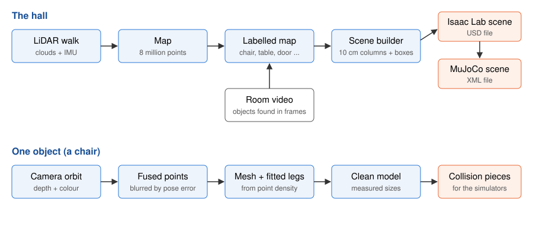
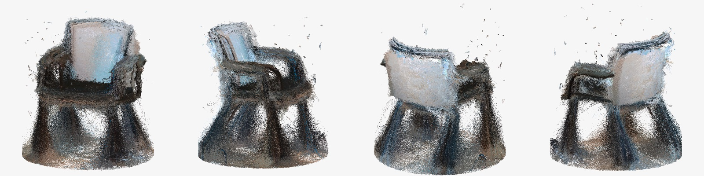
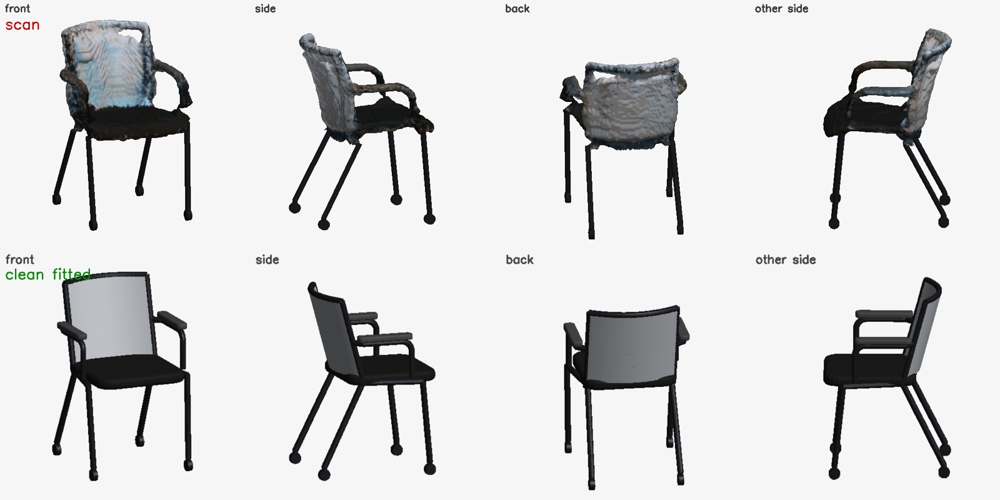

[Back to all setups](index.html)

# Digital twin: from a LiDAR walk to a simulation scene

This page documents how a lab hall of about 28 × 18 m became a scene that a simulated **Unitree G1** can
stand and move in, in two physics simulators, and how one chair was scanned separately and turned into
a clean model. It starts where the [navigation page](navigation.html) ends: with a finished LiDAR map.

Everything here is done. The limits of the result are listed at the end, and they matter: this twin is a
model of **where things are and how big they are**, not of how the room looks.

Last updated: 17 November 2026.

Scripts: [bin/twin/](https://github.com/wookkim1031/g1-setup/tree/main/bin/twin).

---

## What is a digital twin?

A digital twin is a copy of a real place inside a simulator, built from measurements of that place. A
robot policy can then be tested there thousands of times, in parallel, without anything breaking.

What the copy has to be good at depends on what it is used for. A twin for testing how a robot walks, sits
or bumps into things only needs the **shapes** to be right: where the walls and tables are, how high a
seat is. Colours and textures do not matter for that. Ours is this kind.

### The building blocks

| Word | What it is | Here |
|---|---|---|
| **Point cloud** | A list of 3D points measured by a LiDAR or depth camera | The hall map: 8 million points, one per 2 cm cube |
| **Voxel** | A small cube of space. "2 cm voxels" means one point is kept per 2 cm cube | Used to thin the map and to build the scene |
| **Mesh** | A surface made of triangles | The scanned chair |
| **Collision geometry** | The simplified shapes the simulator uses to work out contact | Boxes and columns |
| **Convex shape** | A shape with no dents. Simulators collide these fast and reliably | A chair is split into 17 convex pieces |
| **Physics engine** | The program that works out forces, contact and motion step by step | PhysX (inside Isaac Lab) and MuJoCo |
| **USD** | The scene file format of Isaac Sim and Isaac Lab | `hall_scene.usda` |
| **MJCF** | The scene file format of MuJoCo, written as XML | `scene.xml` |
| **Label** | The class of an object: chair, table, door | Attached to map points and to scene objects |
| **Segmentation model** | A model that marks which pixels of a picture belong to which object | Grounding DINO finds objects by name, SAM 2 outlines them |
| **Structure from motion** | Working out where a camera was for each frame of a video | COLMAP, to place the room video in the map |

### Two layers: what stays and what gets moved

Furniture in a lab is moved all the time. A scene that freezes the layout of the recording day is wrong
the next morning. So the scene is split:

* **Static layer:** walls, pillars, fixed counters. Built once.
* **Movable objects:** chairs, tables, plants. Kept as separate objects, so a script can place them
  differently for every test.

### The pipeline



---

## What we did, at a glance

| Step | Result |
|---|---|
| [1. Map](#1-the-map) | A dense LiDAR map of the hall (see the navigation page) |
| [2. Labels](#2-labelling-objects-from-a-room-video) | Chairs, tables, doors and more marked on the map, from a hand-held video |
| [3. Scene for Isaac Lab](#3-building-the-scene-for-isaac-lab) | 6,168 static boxes plus 146 labelled objects |
| [4. Checking the scene](#4-checking-the-scene) | Collision works; dropped balls rest where they should |
| [5. Scene for MuJoCo](#5-the-same-scene-in-mujoco) | The same hall, 0.7 ms per simulation step on one CPU core |
| [6. One chair](#6-scanning-one-chair) | A clean chair model from a camera orbit, with collision pieces |

---

## Hardware and software

| Part | Details |
|---|---|
| Robot sensors | Livox Mid-360 LiDAR and Intel RealSense D435i depth camera, both in the G1's head |
| Room video | A hand-held webcam, 1080p at 30 frames per second |
| Simulators | Isaac Lab (on a GPU server) and MuJoCo (on a CPU) |
| Tools | DLIO, COLMAP, Grounding DINO, SAM 2, Open3D |

---

## 1. The map

The starting point is the dense map from a ten-minute LiDAR walk: 8 million points at 2 cm. How it is
recorded and built is on the [navigation page](navigation.html).

Two walks were made six days apart. The second map was lined up with the first one automatically (rough
match on coarse features, then fine fitting), so that labels made on the first map stay valid.

## 2. Labelling objects from a room video

The LiDAR sees shapes but does not know what they are. To label them, a person walked through the hall
with a camera, and the objects found in the video were carried over to the map:

1. **COLMAP** works out where the camera was for each sharp frame.
2. The camera path is matched to the LiDAR map by shape alone, since video and LiDAR had no shared clock.
3. **Grounding DINO** finds objects by name in each frame ("chair", "table", ...), and **SAM 2** draws
   their outline.
4. Each outline is projected onto the map points behind it. A point gets a label when at least two
   frames agree.
5. Labelled points that lie close together are grouped into objects.

This is a prototype, and the page should not make it sound better than it is:

* **Only part of the video could be used.** COLMAP loses track when the camera pans quickly and the
  picture blurs. Of a 163-second video, only about one minute could be placed in the map.
* **Fewer than half of the map points were seen by the camera at all** (45 %).
* **Nobody measured how accurate the labels are.** They were checked by eye only.
* **Groups are not objects.** One table can come out as two groups, or two chairs as one.

**What we would do differently:** record the robot's own head camera during the LiDAR walk. Then every
frame already has a position from the LiDAR, and steps 1 and 2 disappear.

## 3. Building the scene for Isaac Lab

```bash
python3 build_isaac_scene.py <labelled_map.ply> <out_dir> --traj trajectory.csv --movable chair table ...
python3 randomize_layout.py <out_dir> --seeds 0 1 2 3 4 5 6 7
```

`build_isaac_scene.py` turns the labelled map into a USD scene:

* **A clean frame.** The map is turned so the walls run along the axes, and the floor is flattened to
  height zero (a plane fitted to the floor removes the slow height drift of the map).
* **Static layer as columns.** The floor is cut into 10 cm cells. Every cell with points between 0.15 m
  and 2.2 m above the floor gets a box from the floor up to its highest point. Neighbouring boxes are
  merged: 14,365 cells became 6,168 boxes.
* **Free paths.** Cells the robot itself walked through during the recording are cleared, since the
  robot was there.
* **Objects as boxes.** Every labelled object becomes one box with its class attached: 42 fixed ones
  and 104 movable ones.

`randomize_layout.py` then writes layouts in which a random share of the movable objects stands
somewhere else on the free floor, without overlapping anything.

**Gotcha: ghost walls from glass.** The LiDAR sees reflections in glass walls and reports points that
are not there, which turned into columns in the middle of nowhere. The fix was to keep a static column
only if it shows up in **both** walks. The cost: something that really was moved between the two days
also drops out of the static layer.

**Gotcha: columns fill the space under tables.** A column goes from the floor to the highest point of
its cell. Under a table top there is then a solid block, not four legs with air between them. For a robot
that walks around tables this is fine; for one that should put its feet under a table it is wrong.

## 4. Checking the scene

```bash
./isaaclab.sh -p check_isaac_scene.py <hall_scene.usda> <scene_report.json> <out_dir> --headless
```

A scene file can look right and still be useless, for example when shapes have no collision or the unit
is centimetres. The check loads the scene in Isaac Lab and tests it:

* Every object has collision and a class label; units are metres, up is z.
* **Ball drop test:** balls are dropped on free floor, on a counter and on a static block. They come to
  rest at the expected heights.

**Gotcha:** on our server, Isaac Sim's renderer crashed at start-up, while physics ran fine. The pictures
of the scene were rendered on another machine with the same software. Physics checks do not need the
renderer; run them `--headless`.

## 5. The same scene in MuJoCo

```bash
python convert_twin.py <hall_scene.usda> <folder with the G1 model> <out_dir>
```

MuJoCo is a second physics engine. It runs on a CPU and gives an independent
answer to "would this also work with different physics?".

Because the whole scene is made of boxes, the conversion is direct: every box becomes a MuJoCo box.
Two checks after converting: the same space is occupied as in the Isaac scene (tested on 200,000 random
points), and the simulated G1 stands at the start position without touching anything.

**Gotcha, and the reason for the boxes:** MuJoCo collides a mesh through its **convex hull**, the
shape you get by stretching a rubber sheet around it. Loading the hall's static layer as one mesh would
turn the whole hall into a single solid block. 6,168 separate boxes avoid that, and still step in about
0.7 ms on one CPU core.

## 6. Scanning one chair

The hall scene has boxes for chairs. For a robot that should sit down, the chair's real shape matters:
seat height, backrest, armrests. So one chair was scanned on its own.

```bash
python3 fuse_object.py <recording> <trajectory.csv> <extrinsics.json> <out_dir> --name chair
python3 mesh_from_points.py <out_dir>/chair_points.ply <out_dir> --name chair
python3 chair_hybrid.py <out_dir>/chair.ply <out_dir> --points <out_dir>/chair_points.ply --name chair
```

The robot, hanging in a gantry, was walked in a full circle around the chair with its head camera
pointed at it (228 seconds). The camera's position for each frame comes from the LiDAR.



The raw points hold every part of the chair, but blurred: each frame's position is slightly
off, so thin parts like the legs smear into cones.

**Gotcha: the standard method lost the legs.** The usual way to fuse depth frames into a mesh (TSDF
fusion) carved the thin legs away and kept only the seat. What worked instead:

1. **Mesh from point density.** Keep only the dense core of the points, where the true surface is, and
   mesh that.
2. **Fit the legs.** In thin slices from the floor up, find the densest spot of each leg and put a
   straight line through them.
3. **Fit a clean model.** Measure seat, backrest and armrests on the scan and build simple shapes
   with those sizes.



For the simulators, the clean model is split into 17 convex collision pieces.

**Not verified:** the scan gives a seat height of 0.50 m. The maker's data sheet says 0.43 to 0.45 m
for this chair. The top of the backrest fits the data sheet (0.88 m against 0.87 m), so the floor level
of the scan seems right, but nobody has put a tape measure on the seat yet. Until then the seat height
is uncertain by several centimetres, which is a lot for sitting.

---

## Limits of this twin

* **Shapes only.** No textures, no materials, walls end at 2.2 m. It cannot be used to train or test
  anything that depends on what the camera sees.
* **Not checked against a tape measure,** except single pieces of furniture.
* **One recording day.** The layout is the one of that day, including an event set-up.
* **Not usable as a target for a simulated LiDAR.** The solid columns block the view in a way the real
  hall does not. A separate, finer model made of small cubes was needed for LiDAR tests.

## Gotchas, in one place

| Problem | Cause | Fix |
|---|---|---|
| Columns in empty space | LiDAR reflections in glass | Keep a column only if two walks agree |
| Solid block under every table | Columns go from floor to the highest point | Accept it, or model tables separately |
| Whole hall is one solid block in MuJoCo | A mesh collides as its convex hull | Use one box per column |
| Chair mesh has no legs | TSDF fusion carves thin parts away | Mesh from point density, fit the legs |
| Only part of the room video usable | Camera tracking breaks at blurry pans | Record the robot's head camera with the LiDAR |
| No pictures from the simulator | Renderer crashed on the server | Run physics headless, render elsewhere |
