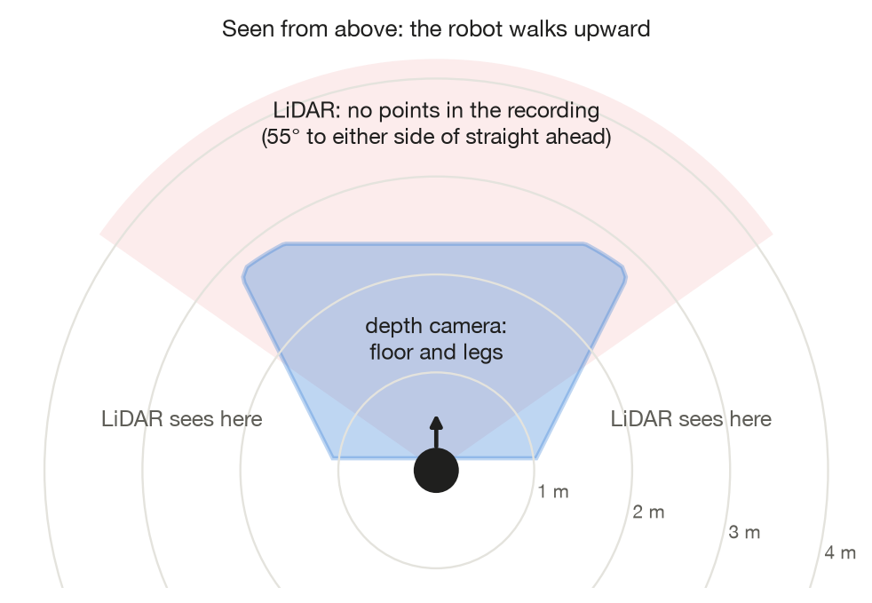

[Back to all setups](index.html)

# A depth camera for the front: closing the gap in the LiDAR's view

This page documents how the **depth camera in the G1's head** is added to Nav2's obstacle avoidance, so
that the robot sees what is straight ahead of it. It is written for someone who has never set up a second
sensor in Nav2.

Last updated: 18 November 2026.

**Status: simulation only.** The camera is modelled with the mounting measured on our real robot, but
nothing on this page has run on the real robot yet. What is still missing for that is listed under
[What a real robot adds](#what-a-real-robot-adds).

New to scans, costmaps or Nav2? Read the [basics page](basics.html) and the
[navigation page](navigation.html) first.

---

## Why a second sensor

Nav2 avoids obstacles with a **costmap**: a small map around the robot in which every cell is free,
occupied or close to something. The costmap is filled from sensor data, normally one laser scan.

On our robot that scan has a hole. The recording of the head LiDAR holds no points within about 55° to
either side of the walking direction (see [The catch on our robot](amcl.html#the-catch-on-our-robot)).
Furniture is still avoided, because the robot sees it from the side before it turns towards it and the
costmap remembers it. A person who steps into the hole and stays there is never seen. In simulation the
robot walked into such a person in each of three runs.

The G1 carries a second sensor that looks exactly there: an Intel RealSense D435i depth camera in the head.

### The words

| Word | What it is |
|---|---|
| **Depth camera** | A camera that gives a distance for every pixel instead of a colour |
| **Costmap** | Nav2's map of where the robot may not go. A local one moves with the robot, a global one covers the hall |
| **Obstacle layer** | The part of a costmap that is filled from live sensor data |
| **Observation source** | One sensor feeding the obstacle layer. There can be several |
| **Marking** | Entering an obstacle into the costmap where the sensor sees something |
| **Clearing** | Erasing obstacles along a sensor ray that passed through free space ("raytracing") |

---

## What the camera sees



| | Value | Where it comes from |
|---|---|---|
| Direction | 58° below level | Measured: a plane fitted to the floor in one depth image of the real robot |
| Height | 1.25 m above the floor | The same measurement |
| Field of view | 87° wide, 58° high | The camera's data sheet |
| Range | up to 3 m | The camera's data sheet |

The camera looks down steeply. That decides everything else:

* It sees the **floor from the robot's feet to about 2.3 m ahead**, and about 60° to either side. That is
  the whole width of the LiDAR's gap, but only close to the robot.
* **How early it sees something depends on how tall the thing is.** The upper edge of the image rises
  towards the robot, so a person is seen from about 2 m (first the feet), something 0.5 m tall from
  1.4 m, something 0.8 m tall only from 0.9 m, and something at 1 m height only from 0.5 m.
* The robot's URDF gives the camera 47.6° of tilt against the torso. The measured 58° is against the
  floor and includes how the robot really stands. Use the measured value.

---

## From depth image to something Nav2 can use

Nav2's obstacle layer takes a flat scan (`LaserScan`) or a point cloud (`PointCloud2`). We turn the
camera into a flat scan with **three possible values per direction**, and the third one matters:

| Value | Meaning | What the costmap does with it |
|---|---|---|
| A distance | The closest point between 0.10 and 1.50 m above the floor in this direction | Marks an obstacle there, clears up to it |
| `inf` | The camera saw the floor at least 1.5 m out in this direction: nothing is there | Clears |
| `nan` | The camera says nothing about this direction (outside its view) | Nothing |

The steps for each depth image:

1. Turn every pixel into a 3D point and rotate it into a **level** frame at the robot, with the tilt
   above. After this, z is height above the floor.
2. Points between 0.10 and 1.50 m high are obstacles. Lower points are floor.
3. For each direction take the closest obstacle point. If there is none and the floor was seen far enough,
   write `inf`. Otherwise write `nan`.

Why not simply leave the empty directions empty? Because then nothing ever **clears** the costmap in
front of the robot. A person who walks across the front would leave a mark that stays for good, and
after a while the robot is fenced in by obstacles that are long gone. The LiDAR cannot clear them, since
it has no rays there.

---

## The Nav2 settings

The camera scan is a **second observation source** next to the LiDAR scan, in both costmaps. ROS 2
Humble. This is the obstacle layer of the local costmap; the global costmap gets the same `cam` block.

```yaml
local_costmap:
  local_costmap:
    ros__parameters:
      plugins: ["obstacle_layer", "inflation_layer"]
      obstacle_layer:
        plugin: "nav2_costmap_2d::ObstacleLayer"
        enabled: true
        observation_sources: scan cam        # two sources: the names of the two blocks below
        scan:                                # the LiDAR scan, as before
          topic: /scan
          data_type: "LaserScan"
          marking: true
          clearing: true
          raytrace_max_range: 8.0
          obstacle_max_range: 6.0
        cam:                                 # the head camera as a flat scan
          topic: /scan_cam
          data_type: "LaserScan"
          marking: true
          clearing: true
          inf_is_valid: true                 # treat inf as a real measurement, so it clears
          raytrace_max_range: 1.5            # clear only as far as the floor was really seen
          obstacle_max_range: 2.5            # mark obstacles up to here
          max_obstacle_height: 2.0
```

What the less obvious lines do, in Nav2's own words from its parameter page:

| Parameter | Nav2's description | Why this value |
|---|---|---|
| `observation_sources` | "Namespace of sources of data" | Two names, separated by a space |
| `inf_is_valid` | "Are infinite returns from laser scanners valid measurements to raycast" | Without it the `inf` readings are thrown away and nothing clears |
| `raytrace_max_range` | "Maximum range to raytrace clear obstacles from costmap" | 1.5 m, the distance up to which we demand that the floor was seen |
| `obstacle_max_range` | "Maximum range to mark obstacles in costmap" | A little more than the 2.3 m the camera reaches on the floor |

Keep `inf_is_valid` **off for the LiDAR source**. Its empty directions mean "saw nothing", not "saw
free space", and clearing with them would erase what the robot remembers in the gap.

---

## What it did in simulation

The same walk with the same simulated people, once with the LiDAR alone and once with the camera added,
for three different sets of people. With the camera there was no contact with the body in any of the
three runs, where the LiDAR alone had one to three in each. The walks took 15 to 33 % longer, because the
robot now waits for the people it sees or walks around them. Runs without people were unchanged.

---

## What a real robot adds

None of this is done yet. It is the list to work through before the camera steers a real robot.

| Topic | Why it matters | Way to handle it |
|---|---|---|
| **The head sways** | The tilt changes with every step. A tilt that is 2° off lifts the floor two metres ahead by about 7 cm, and it becomes an obstacle | Take the tilt of each image from the camera's own motion sensor, or fit the floor plane in every image |
| **The robot sees its own legs** | Feet and knees are inside the image and would be marked as obstacles | Cut away everything closer than about 0.3 m |
| **Things that stick out** | A table top at 0.8 to 1 m is seen only from under 1 m away, and not at all by the LiDAR ahead | Lower walking speed near furniture; keep the furniture on the stored map |
| **Holes in the depth image** | Shiny floors, glass and sunlight give pixels without depth | A hole must become `nan`, never `inf`. This is why "floor seen" is demanded before clearing |
| **Making the scan** | The camera driver gives a point cloud, not a scan | See below |

On a real robot the standard tool for the last row is the `pointcloud_to_laserscan` package. Its
parameters `target_frame`, `min_height`, `max_height`, `angle_min` and `angle_max` cover steps 1 to 3
above, with one difference: it writes `inf` for **every** direction without a point (`use_inf`), whether
the floor was seen there or not. Limit it to the camera's view with `angle_min` and `angle_max`, and
check how it behaves on images with holes before trusting it to clear.

Nav2 can also take the point cloud directly (`data_type: "PointCloud2"`), which skips the flat scan. We
have not tried that.

---

## Gotchas

| Problem | Cause | Fix |
|---|---|---|
| Obstacles in front of the robot never disappear | The camera source does not clear: empty directions are dropped | Write `inf` where the floor was seen, and set `inf_is_valid: true` for that source |
| Obstacles the LiDAR saw vanish again | `inf_is_valid` is on for the LiDAR source too, or the camera scan writes `inf` outside its view | `inf_is_valid` only for the camera; `nan` outside its view |
| The floor shows up as a wall some metres ahead | The tilt used for the camera is wrong, or it changes while walking | Measure the tilt against the floor, not against the torso; correct it per image |
| A ring of obstacles right around the robot | The camera sees the robot's own legs | Cut away points closer than about 0.3 m |
| The robot stops in front of a person and stays there | It sees the person now, and a pure stop rule has no way around | Let Nav2 replan around, or add a rule for waiting and then going around |

---

## Further reading

* Nav2's obstacle layer and all its parameters: [docs.nav2.org, Obstacle Layer](https://docs.nav2.org/rolling/configuration_and_development/configuration_guide/core_servers/costmap_2d/costmap_plugins/obstacle/)
* The converter from point cloud to flat scan: [pointcloud_to_laserscan](https://github.com/ros-perception/pointcloud_to_laserscan)
* Where the gap in the LiDAR's view comes from: [Localisation with AMCL, the catch on our robot](amcl.html#the-catch-on-our-robot)
