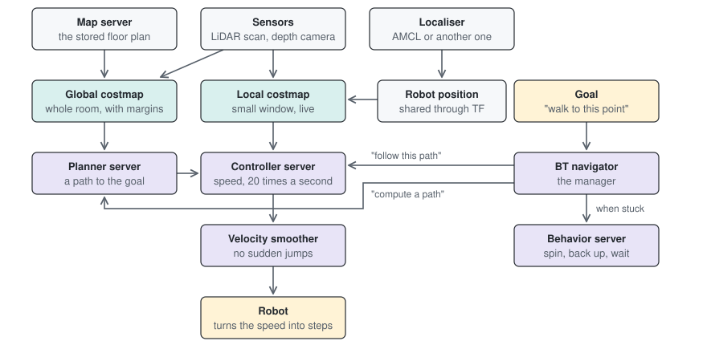
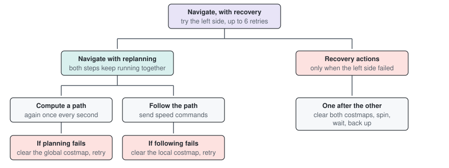

[Back to all setups](index.html)

# Nav2, part by part: what happens between "go there" and the first step

This page explains **Nav2**, the navigation software of ROS 2, as a tool: which programs it consists of,
how a goal travels through them, and how it decides what to do when something goes wrong. It is written
for someone who has seen Nav2 run but could not say what each part does.

Last updated: 21 November 2026.

**Status: explanation, plus what we use in simulation.** Nothing on this page has run on the real robot.

New to maps, scans and TF? Read the [basics page](basics.html) first. How Nav2 fits into our whole
set-up is on the [navigation page](navigation.html).

---

## What is Nav2?

Nav2 is not one program. Its [repository](https://github.com/ros-navigation/navigation2) holds about
thirty packages, and most of them are a small program of their own, called a **server**, that does one
job. They talk to each other over ROS 2. You choose which ones to start and configure all of them in one
settings file.

What goes in: a map, the robot's position, live sensor data and a goal. What comes out: a speed command,
"this fast forward, this fast turning", many times a second. Nav2 does not move legs or wheels. Something
else has to turn the speed command into motion.

---

## The parts

### The ones that do the work

| Part | Package | What it does |
|---|---|---|
| **BT navigator** | `nav2_bt_navigator` | The manager. It receives the goal and tells the other servers what to do and in which order. It computes nothing itself. |
| **Planner server** | `nav2_planner` | Finds a path from the robot to the goal on the global costmap. Called "global planner" in older texts. |
| **Controller server** | `nav2_controller` | Follows that path: about 20 times a second it decides the speed to command now. It looks at the local costmap, so it reacts to things that are not on the stored map. Called "local planner" in older texts. |
| **Smoother server** | `nav2_smoother` | Rounds the corners of the planned path. |
| **Behavior server** | `nav2_behaviors` | Gets the robot out of trouble: spin, back up, wait. Called "recoveries" in older texts. |
| **Velocity smoother** | `nav2_velocity_smoother` | Limits how fast the commanded speed may change. |

### The ones that feed them

| Part | Package | What it does |
|---|---|---|
| **Map server** | `nav2_map_server` | Loads the stored floor plan: a picture with black for walls and white for free floor. |
| **Costmaps** | `nav2_costmap_2d` | Grids of numbers that say how bad it is to be in each cell. Built in layers: the stored map, live sensor hits, and a safety margin around every obstacle. There are two: the **global** one covers the whole room and serves the planner, the **local** one is a small window around the robot and serves the controller. |
| **Localiser** | `nav2_amcl` | Answers "where am I on the map?". AMCL is the one Nav2 ships, explained on [its own page](amcl.html). Nav2 only needs the answer, so another localiser can take its place. |
| **Lifecycle manager** | `nav2_lifecycle_manager` | Starts all servers in the right order and watches that they stay alive. |

### Planners and controllers to choose from

The planner server and the controller server are empty frames. The method they use is a **plugin** that
you name in the settings file, and several come with Nav2:

| Kind | Plugins in the repository | In short |
|---|---|---|
| Planner | NavFn, Smac (2D, Hybrid-A*, lattice), Theta* | NavFn and Smac 2D search a grid for the cheapest route. Smac Hybrid also respects how tightly the robot can turn. |
| Controller | Regulated Pure Pursuit, DWB, MPPI | Pure Pursuit aims at a point a little ahead on the path and slows down in curves and near obstacles. DWB and MPPI try out many possible motions and pick the best. |

---

## How Nav2 decides: the behaviour tree

The BT navigator does not follow fixed code. It follows a **behaviour tree**, a small file that describes
what to try, in which order, and what to do on failure. This is the main difference to the navigation
software of ROS 1, which was one program around a fixed sequence of states. Changing its behaviour meant
changing its code. Here you edit a file.

A tree is made of a few kinds of building blocks. Many times a second the tree is run from the top, and
every block answers with one of three words: **success**, **failure** or **running**.

| Block | What it does |
|---|---|
| **Action** | Does something, for example "compute a path". Answers "running" until it is finished. |
| **Condition** | Checks something, for example "has the goal changed?". Answers success or failure at once. |
| **Sequence** | Does its children from left to right. Fails as soon as one fails. Like "and". |
| **Fallback** | Tries its children from left to right. Succeeds as soon as one succeeds. Like "or". |
| **Decorator** | Has one child and puts a rule on it, for example "only once per second". |

Nav2 adds three of its own:

| Block | What it does |
|---|---|
| **Pipeline sequence** | A sequence that keeps running the earlier children while a later one runs. This is how the path is planned again and again while the robot is already following it. |
| **Recovery** | Two children: the main action and what to do if it fails. After the second child has run, the main action is tried again, up to a set number of times. |
| **Round robin** | Tries its children in turn, a different one each time it is asked. Used to rotate through the recovery behaviours. |

### The standard tree

Read from the top:

1. **Compute a path**, and do it again once every second, so the path follows what the sensors see.
   If no path is found, clear the global costmap and try once more.
2. **Follow the path.** If the controller gives up, clear the local costmap and try once more.
3. If steps 1 and 2 together still fail, run the **recovery actions**: clear both costmaps, spin, wait,
   back up. Each failure uses the next one.
4. Start again at step 1. After six rounds without success, the goal is **aborted**.

So "Nav2 aborted the goal" does not mean one thing went wrong. It means every retry and every recovery
was used up. Clearing a costmap is the mildest recovery: it throws away obstacles that the sensors saw
once and that may no longer be there.

The retry counts and the one-second rate are those of the standard tree as walked through in the video
under [Further reading](#further-reading); they are numbers in the tree file and can be changed there.

---

## Three extras worth knowing

These come with Nav2 and need no programming, only settings and, for the first two, a second picture of
the map on which areas are painted.

| Extra | What it does | Do we use it? |
|---|---|---|
| **Keepout filter** | Areas painted on a copy of the map are never entered. Painted the other way round, it gives lanes the robot must stay on. | Not yet. A way to keep the robot off a stage or out of a seating area. |
| **Speed filter** | Areas painted on a copy of the map limit the speed, for example to half. | Not yet. Our walker has a slowest walking speed, so a slow zone cannot go below that. |
| **Collision monitor** | Watches the sensors directly, independent of planner and controller. Slows the robot when something is near and stops it when something is inside a stop zone around the robot. | Not yet. The first thing to add before a real robot walks, because it still stops the robot when everything above it is wrong. |

Newer releases also have a **route server** that plans along a fixed network of routes instead of freely
across the floor, the way people walk along corridors.

---

## What we use

The simulated robot runs Nav2 from the ROS 2 release Humble with these choices:

| Slot | Our choice | Why |
|---|---|---|
| Planner | Smac 2D | A plain grid search is enough in an open hall. |
| Controller | Regulated Pure Pursuit | Smooth, slows down near obstacles, few settings. |
| Smoother | Simple smoother | Takes the corners off the grid path. |
| Behaviors | Spin, back up, drive on heading, wait | The standard set. |
| Global costmap | Stored map, live obstacles, safety margin | |
| Local costmap | Live obstacles, safety margin | Fed by the LiDAR scan and the [forward camera](front-camera.html). |
| Localiser | AMCL in some tests, 3D scan matching in others | See [the AMCL page](amcl.html) for why. |
| Behaviour tree | The standard one | Unchanged. |

Three things are different for a walking robot and show up in the settings:

* **It cannot walk arbitrarily slowly.** Below a certain speed command the walker just stands. The
  controller's lowest speed has to stay above that, or the robot stops short of every goal.
* **It sways.** The position jitters by a few centimetres with every step, so the goal tolerance cannot
  be as tight as for a wheeled robot. Ours is 0.35 m.
* **Its outline is wider than its feet.** Arms swing beside the body. The safety margin in the costmaps
  has to cover the hands, not the hips.

---

## Gotchas

| Problem | Cause | Fix |
|---|---|---|
| A goal "succeeds" the moment it is set | The robot already stands within the goal tolerance | Set the goal further away |
| The goal is refused at once | It lies on an obstacle or inside the safety margin of one | Click on free floor, away from furniture |
| The robot stops a little short of the goal and stays there | The controller commands a speed below what the robot can walk | Raise the controller's lowest speed |
| Goal aborted after a long wait | All retries and recoveries were used up, often because something stands on the only way | Look at the costmaps in RViz: what blocks the path? |
| Nothing starts and no error is shown | One server did not come up, and the lifecycle manager waits for it | Read the log of the first server that failed |
| Obstacles stay on the map after they are gone | The costmap only clears a cell when a sensor beam passes through it | Make sure a sensor looks there, or let the recovery clear the costmap |

---

## Further reading

* The source code and the list of packages: [github.com/ros-navigation/navigation2](https://github.com/ros-navigation/navigation2)
* Nav2's own documentation: [docs.nav2.org](https://docs.nav2.org/)
* A video that explains behaviour trees step by step and then runs Nav2 on a small wheeled robot, with
  demos of the keepout and speed filters:
  [Navigation2 in ROS2, by Robotics and ROS Learning](https://www.youtube.com/watch?v=sVUKeHMBtpQ)
* The same parts seen from our set-up: [navigation](navigation.html), [AMCL](amcl.html),
  [forward camera](front-camera.html)
