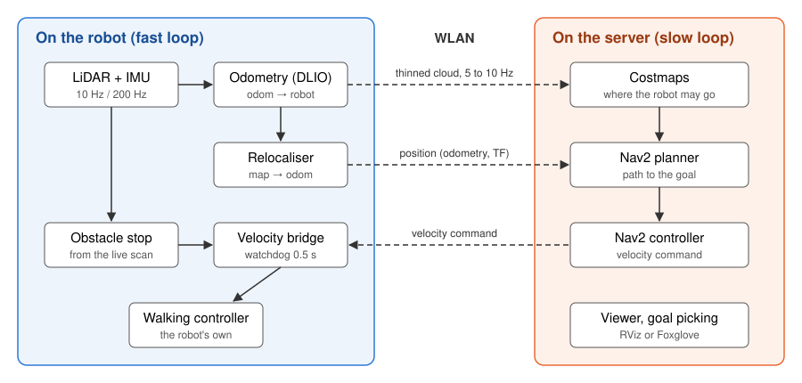

[Back to all setups](index.html)

# Navigation: from a LiDAR scan to "walk to that chair"

This page documents how a **Unitree G1** humanoid is being set up to find its way through a lab hall of
about 28 × 18 m: reading its LiDAR, building a map, knowing where it is on that map, and planning a path.
It is written **while the setup is being built**. Steps 1 to 3 are done and describe what worked. Steps 4 to 8
are planned and describe what we intend to do and why; they will be rewritten with what really happened.

Last updated: 17 November 2026.

Everything in steps 1 to 3 only **listens** to the robot. No script on this page sends it a command yet.

New to LiDAR, odometry or TF? Read the [basics page](basics.html) first.

Scripts: [bin/](https://github.com/wookkim1031/g1-setup/tree/main/bin).

---

## What is navigation?

Navigation answers three questions, over and over, while the robot moves:

1. **Where am I?** (localisation)
2. **How do I get to the goal?** (planning)
3. **What do I do in the next split second?** (control)

The robot answers them with a spinning laser scanner in its head and a motion sensor, a stored map of
the hall, and a planner that turns "go to the chair" into "walk forward at 0.3 m/s and turn slightly left".

### The building blocks

| Word | What it is | Here |
|---|---|---|
| **LiDAR** | A laser scanner. It measures the distance to whatever each laser beam hits | Livox Mid-360 in the G1's head, mounted upside down |
| **Point cloud** | One sweep of the LiDAR: a list of 3D points | 10 clouds per second, about 8,300 points each in this hall |
| **IMU** | A motion sensor: how fast the head turns and accelerates | Built into the LiDAR, 200 readings per second |
| **Odometry** | The robot's own estimate of how far it has moved since it started. Smooth, but small errors add up (*drift*) | DLIO, from LiDAR + IMU |
| **Map** | All clouds of one walk merged into a single 3D picture of the hall | 8 million points at 2 cm |
| **Localisation** | Finding the robot's position *on the stored map*, which removes the drift | Planned (step 4) |
| **Frame** | A coordinate system. `map` is fixed to the hall, `odom` starts where the robot was switched on, `base_link` is the robot | `map → odom → base_link` |
| **TF** | The ROS tool that keeps track of how all frames sit relative to each other | Published by DLIO and the localiser |
| **Costmap** | A floor plan where every cell says how risky it is to stand there | Nav2, from the map and the live scan |
| **Global planner** | Finds a path through the costmap from here to the goal | Nav2 |
| **Local controller** | Follows that path and outputs a velocity many times a second | Nav2 |
| **Velocity command** | "Forward 0.3 m/s, turn 0.1 rad/s". In ROS this is the topic `/cmd_vel` | Sent to the robot's walking controller |
| **Nav2** | The standard ROS 2 navigation package: costmaps, planners and controllers in one | Planned (step 6) |
| **Watchdog** | A safety timer: if no new command arrives in time, command zero | Planned (step 7) |

### Odometry and localisation are two different things

This is the part that confuses most people at first.

* **Odometry** is like counting your steps with your eyes closed. It is smooth and always available, but
  after ten minutes you are a little off, and you have no idea where the door is.
* **Localisation** is like opening your eyes and recognising the room. It tells you where you are on the
  map, but it can jump when it corrects itself.

Navigation uses both: odometry for the smooth short-term motion (`odom → base_link`), and localisation
for the slow correction (`map → odom`). The planner works in the `map` frame, because the goal ("that
chair") is a place on the map.

### How the pieces are split between robot and server



The robot has a small onboard computer and a wireless link. The heavy planning runs on a server. The rule
for the split: **everything that must keep working when the wireless link stalls stays on the robot.**
That is the sensor driver, odometry, localisation, the stop when something is in the way, and the watchdog.

---

## What we did, at a glance

| Step | Result | Status |
|---|---|---|
| [1. Reading the LiDAR](#1-reading-the-lidar-without-ros) | Point clouds and IMU recorded straight from the robot's network | Done |
| [2. Recording a walk](#2-recording-a-walk) | A 10-minute loop through the hall, start = end | Done |
| [3. Odometry and map](#3-odometry-and-a-map-with-dlio) | DLIO map of the hall; drift under 3 cm over 102 m | Done |
| [4. Localisation](#4-localisation-on-the-stored-map-planned) | Position on the stored map | Planned |
| [5. Robot and server](#5-splitting-the-work-between-robot-and-server-planned) | What runs where, and what crosses the wireless link | Planned |
| [6. Nav2](#6-nav2-on-the-server-planned) | Path planning to a goal on the map | Planned |
| [7. Velocity bridge](#7-velocity-bridge-watchdog-and-obstacle-stop-planned) | Commands reach the walking controller, with a safety timer | Planned |
| [8. Hand-over](#8-hand-over-at-the-object-planned) | Arrive in front of an object precisely enough for a trained skill | Planned |

---

## Hardware

| Part | Details |
|---|---|
| Robot | Unitree G1 with its onboard computer |
| LiDAR | Livox Mid-360 in the head, **mounted upside down**, with a built-in IMU |
| Head camera | Intel RealSense D435i (depth + colour), recorded alongside the LiDAR |
| Recording PC | Laptop with Ubuntu 22.04 and ROS 2 Humble, one Ethernet cable to the robot |
| Server | A PC with a GPU, for planning and viewing |

---

## 1. Reading the LiDAR without ROS

The G1 already publishes its LiDAR and IMU on its internal network, using DDS (the network layer that
ROS 2 is built on). So the first recorder needs no ROS at all, only Unitree's Python SDK:

| DDS topic | Content | Rate |
|---|---|---|
| `rt/utlidar/cloud_livox_mid360` | point cloud | 10 Hz |
| `rt/utlidar/imu_livox_mid360` | IMU | 200 Hz |

```bash
python g1_lidar_rec.py probe                      # 6 s: rates, points per cloud, frame names
python g1_lidar_rec.py record --out ~/bags/<name> # Ctrl-C stops and prints the counts
```

The recorder writes each message as it arrives into a plain file. Converting to a ROS format comes
later, so nothing can go wrong during the walk except losing the cable.

**Note:** the network interface the cable is plugged into has to be named in the DDS settings
(`CYCLONEDDS_URI` at the top of the script).

## 2. Recording a walk

A map is only as good as the walk it comes from. What worked:

* **Stand still at the start** for at least 10 seconds. DLIO uses this time to calibrate the IMU.
* **Start and end on the same floor mark.** Then the end position of the odometry can be compared with
  the start, which is the only honest drift check without extra equipment.
* **Walk slowly** (ours averaged 0.17 m/s) and cover every part of the hall once.
* **Stand still again at the end.**

The walk used for the map: 599 seconds, 102 m, 5,971 clouds, no gaps.

**Gotcha, the one that cost a whole walk:** on the first attempt the Ethernet cable to the laptop came
loose three times. The LiDAR data has holes of up to four minutes and only the first 570 seconds were
usable. Secure the cable, or record on the robot's own computer.

**Gotcha:** to record the head camera at the same time, Unitree's own video service on the robot
(`video_hub_pc4`) had to be switched off, because it holds the camera.

**Gotcha:** the robot's clock and the laptop's clock differed by 30 to 40 ms. If camera frames are to be
matched to LiDAR poses later, measure the offset before and after the walk.

## 3. Odometry and a map with DLIO

**DLIO** (Direct LiDAR-Inertial Odometry) takes the clouds and the IMU and works out how the sensor
moved. Merging all clouds along that path gives the map. We ran it **offline**, on the recording, in a
Docker container. That way the walk and the mapping are separate, and the mapping can be repeated with
other settings.

```bash
docker build -t dlio-humble -f bin/Dockerfile.dlio bin/
docker run --rm -it -v $PWD:/data dlio-humble bash

# inside the container
python3 /data/bin/pkl_to_ros2bag.py /data/<rec> /data/<rec>/bag --restamp-imu   # recording -> ROS 2 bag
/data/bin/dlio_run.sh /data/<rec>/bag /data/<rec>/run1 0.5 42                   # DLIO at half speed, domain 42
python3 /data/bin/dense_map.py /data/<rec>/run1 /data/<rec>/out --name hall     # all scans -> one 2 cm map
python3 /data/bin/lidar_map_report.py /data/<rec>/run1 /data/<rec>/out --name hall  # path, drift check, top view
```

The result for the 102 m loop: a map of 8 million points at 2 cm, with single, straight walls. The end of
the odometry path was 12.5 cm from its start. A separate comparison of the first and last scans gave
13.0 cm, so almost all of that is where the robot really stopped, not drift. **DLIO's own drift over the
ten minutes was about half a centimetre and a tenth of a degree**, which is below what this check can
resolve; the safe statement is under 3 cm and under 0.5°.

Getting there took six runs on the first recording. The settings that mattered:

* **The LiDAR is upside down in the G1's head.** DLIO assumes gravity points down in the sensor's frame.
  Set `odom/imu/approximateGravity: true`, or the map tilts and the run diverges.
* **The time stamp of each point is in nanoseconds** in the robot's data. DLIO expects seconds. The
  converter fixes this.
* **The IMU messages arrive in bursts**, several with almost the same receive time. The converter
  re-stamps them evenly (`--restamp-imu`).
* **DLIO dropped scans when replaying at full speed.** Replaying at half speed with large, reliable
  message queues fixed it (the patch is `bin/dlio_g1_patches.diff`).
* **Never run two DLIO instances in the same DDS domain.** They read each other's data. The run script
  refuses to start if one is still alive, and uses its own domain so it never touches the robot's.

### What a simulated LiDAR told us before going further

Before building localisation, we replayed the real scan pattern in a simulated copy of the hall. These
numbers are a best case, because a simulated LiDAR is cleaner than a real one:

* **Moved furniture is not the problem.** With most chairs and tables moved, following the robot's
  position on the old map still worked to a few centimetres.
* **A lost position is the problem.** Starting 25 cm and 5° off, the localiser always recovered. At
  50 cm and 10° it recovered in about half of the tries on real scans. At 1 m and 20° it never did.
* **Do not throw away the low points.** Keeping only points above head height (to ignore furniture)
  made things worse: the upside-down sensor mostly looks down and sees few points up there.
* **To check on the robot:** the scans have almost no points straight ahead of the sensor. If that is the
  walking direction, the LiDAR does not see what the robot walks into, and the head camera has to cover it.

## 4. Localisation on the stored map (planned)

DLIO alone starts at zero every time the robot is switched on. To navigate to a place on the map, the
robot needs to find its position on the **stored** map. The plan:

* Keep DLIO for the smooth motion (`odom → base_link`).
* Add a relocaliser that matches the current scan against the stored map and publishes the slow
  correction (`map → odom`).
* Give it a rough starting position, for example a marked start spot. The simulation above says the
  matcher needs to start within about 25 cm and 5° to be reliable.

Open: which relocaliser, and how it behaves on the robot's own computer. One candidate, Nav2's AMCL, is
explained and tried in simulation on its own page: [Localisation with AMCL](amcl.html).

## 5. Splitting the work between robot and server (planned)

Why not send everything to the server and compute there?

* **Size.** Raw point clouds are large. Over a wireless link, big messages are cut into pieces, and one
  lost piece means the whole message is sent again. Delay builds up quickly.
* **Timing.** Odometry needs the IMU at 200 Hz with exact time stamps. Wireless delay varies from
  message to message, which hurts odometry directly.
* **Safety.** If the link drops, the robot must not keep walking on its last command.

So the split is the one in the diagram above:

| Where | What |
|---|---|
| On the robot | LiDAR driver, DLIO, relocaliser, obstacle stop, velocity bridge |
| On the server | Nav2 (costmaps, planning), viewer, goal selection |
| Over the wireless link | Position and TF, a thinned-out cloud at 5 to 10 Hz, the velocity command back |

Practical points we plan to follow, to be confirmed by measurement:

* Send clouds as `BEST_EFFORT`: a lost cloud is dropped, not resent.
* DDS discovery by multicast is often unreliable over wireless. Either list the two computers explicitly
  in the DDS settings, or bridge only the chosen topics with a tool such as `zenoh-bridge-ros2dds`.
* Synchronise the clocks of robot and server (for example with `chrony`). Otherwise position look-ups fail,
  because the two computers disagree about what "now" is.

## 6. Nav2 on the server (planned)

Nav2 will get the stored map, the robot's position and the thinned live cloud, and produce velocity
commands toward a goal. Things that are different for a walking humanoid and need tuning:

* The robot sways while walking, so the position jitters by a few centimetres.
* It cannot turn on the spot as cleanly as a wheeled robot, and it needs room to stop.
* Speeds are low (well under 1 m/s), so the controller's limits have to be set for that.

## 7. Velocity bridge, watchdog and obstacle stop (planned)

A small program on the robot will take the velocity command and pass it to the robot's walking
controller. Two safety functions sit in it:

* **Watchdog:** if no velocity command arrives for 0.5 seconds, command zero. With a wireless link this
  is not optional.
* **Obstacle stop on the robot:** if the live scan shows something close in the walking direction, command
  zero, whatever the planner says. The watchdog only reacts after the link has been silent for half a
  second; this stop does not depend on the link at all.

Robot tests of this step are done with a person next to the robot and the robot in a harness.

## 8. Hand-over at the object (planned)

Navigation brings the robot near an object. A trained skill, for example sitting down, then takes over.
The skill only works if the robot stands in the right place, so two things are needed:

* **A number for "close enough":** how many centimetres and degrees of error the skill tolerates.
* **A last alignment step from the robot's own sensors.** Chairs on castors move, so the chair's position
  on the map is out of date as soon as someone pushes it. The final approach has to use what the robot
  sees at that moment.

---

## Gotchas so far, in one place

| Problem | Cause | Fix |
|---|---|---|
| Holes in the recording | Ethernet cable came loose during the walk | Secure the cable, or record on the robot |
| Map tilts, DLIO diverges | LiDAR is upside down | `approximateGravity: true` |
| DLIO loses track during replay | Scans dropped at full speed | Half speed, large reliable queues |
| Garbage odometry | Two DLIO instances in one DDS domain | One instance, own domain |
| Head camera gives no frames | Unitree's video service holds the camera | Stop `video_hub_pc4` for the recording |
| Drift number looks large | The robot did not stop exactly on the start mark | Compare first and last scan directly |
