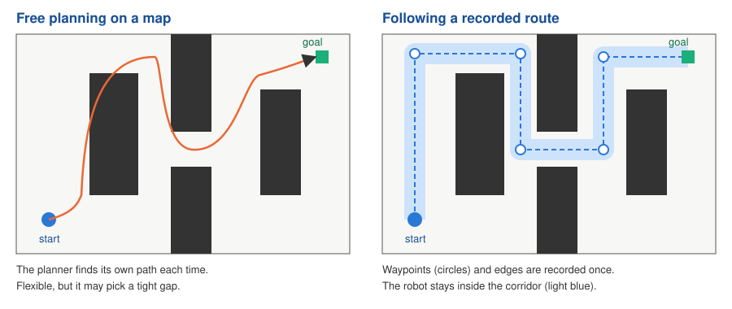

[Back to the research overview](research.html)

# Routes and waypoints: how commercial robots choose where to walk

There are two ways to tell a robot where to walk. **Free planning** hands the robot a map and a goal and
lets a planner find any path. **Route following** records the paths once, as a chain of waypoints, and the
robot stays on them. We started with free planning. The commercial walking robots mostly follow routes.

## What companies do

### Spot (Boston Dynamics): a recorded graph

Spot's navigation system is called GraphNav. Its developer documentation describes it [1][2]:

| Part | How it works |
|---|---|
| The map | A graph of **waypoints** joined by **edges**. Each waypoint stores a snapshot of what the sensors saw there. There is no single global map frame. |
| Recording | A person drives the robot through the building once. |
| Knowing where it is | The robot's position is given relative to a waypoint. To start, it is placed near a printed marker that was seen during recording, or its position is set by hand. |
| Walking | It moves from waypoint to waypoint and has to stay inside a corridor around each edge. |
| Obstacles | It can go around an obstacle, but stays close to the recorded route. If it gets too far from the route, it reports itself as stuck. |
| Choosing a route | The program can ask for a destination waypoint and let the robot pick the route, or hand over an exact route. |
| Special edges | An edge can carry extra information, for example that it goes over stairs. |

Stated limits: the robot does not recover by itself when it has lost its position, and its position
estimate gets worse in places with few features or where the room has changed.

Spot's walking itself combines a learned policy with a model-based controller [3].

### ANYmal (ANYbotics)

ANYmal's specification sheet describes waypoints that the operator defines and edits in a program, with the
robot taking the shortest route between them [4]. We saw this only as a search result, not the full sheet.

### Warehouse and service robots

Amazon's Proteus moves freely among employees and uses several kinds of sensors together; how it plans is
not published [5]. For the other makers we looked at (MiR, OTTO, Locus, Keenon, Bear Robotics) nothing
public describes the planner. Robots from different makers talk to a fleet manager through a common
standard called VDA 5050.

## The same ideas in Nav2

Nav2 is the navigation software we use. It has several route and waypoint tools, some in our release
(Humble, 2022), some only in newer ones.

| Tool | What it does | In our release? |
|---|---|---|
| **Waypoint Follower** | Takes a list of goals and visits them in order. A plug-in can do a task at each one, such as waiting. One setting decides whether a failed waypoint stops the whole list. Nav2 calls it a sample application: fine for simple tours, while a larger system would use its own mission logic [6]. | Yes |
| **Navigate through poses** | One trip through several poses without stopping at each. | Yes |
| **Keepout zones** | Areas painted on the map that the planner never enters. | Yes |
| **Speed zones** | Areas where the speed limit is lower. | Yes |
| **Route Server** | A graph of nodes and edges, written by hand or generated, stored as a GeoJSON file. It can replace free planning where the robot must follow a route closely, or guide the planner over long distances. Edges can be scored by distance, time or how blocked they are; a blocked edge can be closed so the robot takes another. Things can be triggered at a node or on entering an edge, such as a speed limit. Named uses: route following, several floors, and teach-and-repeat [7]. | No. First in Kilted (2025) [8] |

## What each approach is good and bad at

| | Free planning | Recorded routes |
|---|---|---|
| Setting it up | Needs only the map | Someone has to record or draw the routes |
| New goals | Any free point on the map | Only places on the graph (or a short free stretch from the nearest waypoint) |
| Narrow places | The planner may choose a gap the robot barely fits | The route was chosen by a person who knew it fits |
| Furniture moved | Finds a new path by itself | May be blocked; needs another edge or a short detour |
| Predictability | The path differs from run to run | People in the building learn where the robot walks |
| Our experience | Got stuck between chair rows with a circular footprint | Not tried yet |

## Options for our robot

These are options, from least to most work:

1. **Waypoint list with the tools we have.** Mark a handful of named places in the hall (door, counter,
   stage, chairs) and send them as a list. This is "setting the goal" in its simplest form.
2. **Keepout zones** around the areas the robot should never enter, such as the chair rows during an
   event. Free planning then works in the rest.
3. **A hand-drawn route graph**, used with free planning: plan freely to the nearest node, follow the
   graph, plan freely for the last stretch. Possible in our release with some own code.
4. **Nav2's Route Server**, which does option 3 properly. It needs a newer Nav2, which means a newer
   Ubuntu and ROS 2 release on the navigation computer.
5. **Record instead of draw:** walk the robot through the hall by remote control once and turn the walked
   path into the graph, as Spot does.

## Sources

1. Boston Dynamics, GraphNav Technical Summary. <https://dev.bostondynamics.com/docs/concepts/autonomy/graphnav_tech_summary> (developer documentation)
2. Boston Dynamics, GraphNav Service. <https://dev.bostondynamics.com/docs/concepts/autonomy/graphnav_service> (developer documentation)
3. Boston Dynamics, Starting on the Right Foot with Reinforcement Learning. <https://bostondynamics.com/blog/starting-on-the-right-foot-with-reinforcement-learning/> (company blog)
4. ANYbotics, ANYmal technical specifications. <https://www.anybotics.com/anymal-technical-specifications.pdf> (specification sheet; seen as a search result only)
5. The Robot Report, How Amazon developed precision autonomy for Proteus, 31 August 2022. <https://www.therobotreport.com/how-amazon-developed-precision-autonomy-for-proteus/> (news)
6. Nav2 Waypoint Follower, README for Humble. <https://github.com/ros-navigation/navigation2/blob/humble/nav2_waypoint_follower/README.md> (documentation)
7. Nav2 Route Server, README. <https://github.com/ros-navigation/navigation2/blob/main/nav2_route/README.md> (documentation)
8. Nav2 Kilted Release, 2 June 2025. <https://discourse.openrobotics.org/t/nav2-kilted-release/44079> (maintainer's announcement)
