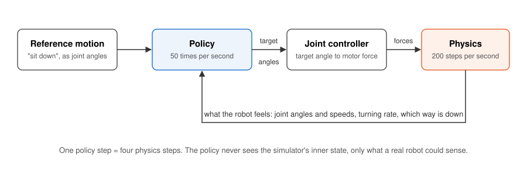
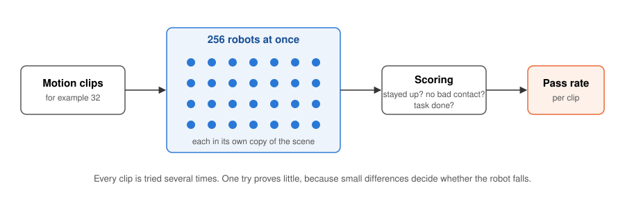

[Back to all setups](index.html)

# Simulation: testing a humanoid a thousand times before it moves once

This page documents how a **Unitree G1** is simulated on a GPU server with **Isaac Lab**: what the
simulator does, how the robot is controlled inside it, how one test run works from start to finish, how
long it takes, and how several jobs share one graphics card. A second simulator, **MuJoCo**, is used to
double-check.

Everything here is set up and in daily use. The page describes the tools and the set-up, not experiment
results.

Last updated: 18 November 2026.

---

## What is a physics simulator?

A physics simulator is a program that works out, in small time steps, what happens to bodies under
forces: gravity pulls, motors push, feet press on the floor, things collide. Give it a robot model and
motor commands, and it tells you how the robot moves.

Why bother, when there is a real robot?

* **Nothing breaks.** A fall in simulation costs nothing. A fall of a real humanoid can cost a repair.
* **Many at once.** One graphics card simulates hundreds or thousands of robots side by side. A test
  that would take a week on one real robot takes a minute.
* **The same test again.** A run can be repeated exactly, which a real robot never allows.

The price: a simulated robot is not the real one. Friction, motor behaviour and sensor noise are only
approximated. What works in simulation is a candidate, not a proof.

### The building blocks

| Word | What it is | Here |
|---|---|---|
| **Isaac Sim** | NVIDIA's robot simulator: physics on the graphics card, plus rendering | Version 5.1 |
| **Isaac Lab** | A layer on top of Isaac Sim for running many robots in parallel and for training | Version 2.3.2 |
| **Physics engine** | The part that computes forces and contacts | PhysX, inside Isaac Sim |
| **Time step** | How much time one physics step covers | 5 ms, so 200 steps per second |
| **Environment** | One robot with its own copy of the scene | 64 to 2,048 per check |
| **Policy** | The program that decides the next motor command from what the robot senses. A neural network | Runs 50 times per second |
| **Observation** | What the policy gets to see | Joint angles and speeds, turning rate, which way is down, its own last command |
| **Action** | What the policy outputs | A target angle for each of the 29 joints |
| **Joint controller** | Turns a target angle into a motor force, like a spring pulling the joint to the target | In the simulator and in the real robot |
| **Episode / rollout** | One try, from start until the motion ends or the robot falls | A few seconds |
| **Termination** | The rule that ends an episode early | For example: the robot strays too far from its target motion |
| **Seed** | The starting number of the random generator. Same seed, same run | We use three seeds per test |
| **Domain randomisation** | Changing friction, masses and so on a little for every robot | So that nothing depends on one lucky setting |
| **Headless** | Running without a window | Always, on the server |
| **Container** | A packaged system with everything the simulator needs | Docker, see below |

### The control loop



Two speeds matter. The physics runs 200 times per second. The policy only decides 50 times per second,
so each of its commands holds for four physics steps. This is the same on the real robot: the brain is
slower than the muscles.

### What the robot is asked to do: motion tracking

Our policy is a **motion tracker**. It gets a **reference motion**, a short recording of how the body
should move ("walk three steps, turn, sit down"), given as joint angles over time. Its job is to make
the simulated body follow that motion without falling. The reference only says where the limbs should
be. Keeping balance, pressing the right amount on each foot, and recovering from a slip are the
policy's own work.

The tracker used here is pretrained and is not changed. Reference motions come either from recordings
of people or from a model that generates a motion from a text description.

### How such a policy is made: reinforcement learning

A policy is not programmed, it is trained. Thousands of simulated robots try, a **reward** tells each
how well it did, and the network is adjusted to make rewarded behaviour more likely. Repeat millions of
times. The usual method is called **PPO**. Training a small add-on skill for this robot used about 4,000
robots in parallel and roughly three hours on one graphics card. This is where the "many at once" of a
simulator pays off most.

---

## What we did, at a glance

| Step | Result |
|---|---|
| [1. Server and container](#1-the-server-and-the-container) | Isaac Lab runs in a Docker container on a GPU server, without a screen |
| [2. Physics settings](#2-physics-settings-and-why-not-to-speed-them-up) | 5 ms steps, policy at 50 Hz; faster settings could not be shown to be safe |
| [3. Scenes](#3-scenes-for-many-robots) | Every robot gets its own copy of a small scene |
| [4. A check run](#4-a-check-run-from-start-to-finish) | Clips in, pass rates out, with three conditions for a pass |
| [5. How long it takes](#5-how-long-it-takes) | About half a minute for 256 robots |
| [6. Sharing one graphics card](#6-sharing-one-graphics-card) | One job at a time, queued, with checks for memory and disk |
| [7. A second simulator](#7-a-second-simulator-mujoco) | MuJoCo as an independent check |

---

## Hardware and software

| Part | Details |
|---|---|
| Server | One NVIDIA RTX PRO 4500 graphics card with 32 GB, 30 GB of main memory |
| Simulator | Isaac Sim 5.1 with Isaac Lab 2.3.2, in a Docker container |
| Second simulator | MuJoCo 3.16 |
| Robot model | Unitree G1 with 29 joints |

---

## 1. The server and the container

Isaac Lab needs a specific graphics driver, Python version and a long list of libraries. NVIDIA ships
all of it as a Docker **container**: a sealed box with its own system inside. We start that container
once and leave it running; every simulation is a command sent into it.

```bash
docker exec -it isaaclab bash                         # a shell inside the container
/workspace/isaaclab/_isaac_sim/python.sh my_run.py    # Isaac's own Python, not the system's
./isaaclab.sh -p my_run.py --headless                 # the same through Isaac Lab's launcher
```

Three things to know before the first run:

* **Use Isaac's own Python.** The simulator brings its own. The system's Python does not find it.
* **Start-up takes time.** Every run first loads the simulator, about half a minute, before the first
  robot moves.
* **Files inside the container live in a Docker volume**, not in a normal folder of the server. They
  count against the disk Docker sits on.

**Gotcha: the picture renderer crashed, physics did not.** On this server Isaac Sim's renderer fails at
start-up. Everything on this page runs `--headless` and needs no picture. For pictures and videos the
same container was run on another machine.

**Gotcha: the clock inside the container is not the server's.** Log files written inside show UTC, the
server shows local time. An "error at 14:10" in one log is "15:10" in the other.

## 2. Physics settings, and why not to speed them up

| Setting | Value | Meaning |
|---|---|---|
| Time step | 5 ms | 200 physics steps per second |
| Decimation | 4 | The policy acts every 4th physics step: 50 times per second |
| Solver iterations | 8 position, 4 velocity | How carefully contacts are resolved in each step |
| Randomisation | on | Floor friction and some body masses differ per robot |

These are the settings the tracker was trained with, and that is the reason to keep them.

**Gotcha: faster settings could not be shown to be safe.** Fewer solver iterations save about a
quarter of each step, and bigger time steps save more. We tried both. Compared with the reference
settings, single tries flipped between pass and fail about as often as they do between two random
seeds. So the test could not tell a real change from chance, and "probably the same" is not good
enough for numbers one wants to rely on. A policy is tuned to the physics it was trained in. Cheaper
settings are fine for a quick look; everything else stays on the training settings.

## 3. Scenes for many robots

Each robot stands in its own copy of a small scene: a floor tile with one object, for example a chair,
a table or a box to walk around. The copies are laid out in a grid.

* **Robots do not collide with each other.** Several robots can even share one tile and walk through
  each other; each only touches the floor and its own object.
* **One clip, several robots.** The same reference motion is given to several robots at once. They
  differ in friction, masses and small disturbances, so one run already shows how reliable a motion is.
* **Scene parameters go in columns.** If the test is "chair at eight different positions", each column
  of the grid gets one position, and every clip is played in every column.

A large scanned hall is handled differently: there is **one** copy of the hall and all robots stand in
it, passing through each other. Giving every robot its own hall is too heavy, and Isaac Lab's contact
filtering did not accept it.

**Gotcha: robots standing next to their scene.** In an early run every robot was placed just outside
its room, on the bare ground, and did its motion there. The results looked plausible. It was
caught from the height of the pelvis. Lesson: check one simple number that
proves the robot is where the scene is.

## 4. A check run, from start to finish



A check answers: "does this motion work in this scene?". The answer is a pass rate, not yes or no.

1. **Load the clips.** Each reference motion is assigned to several robots.
2. **Roll out.** All robots play their clip to the end, or until they fall.
3. **Score every robot.** A try passes only if three things hold:
   * **It stayed with the motion:** the tracker did not give up before the clip ended.
   * **No wrong contact:** nothing touched the object except the body parts that are meant to. For
     sitting, the pelvis and legs may touch the chair, the head may not.
   * **The task was done:** a simple geometric test of the result. For sitting: the pelvis ends above
     the seat and presses on it. For walking around a box: the robot ends beyond it and never touched it.
4. **Count.** Passes divided by tries, per clip.

**The lesson behind the third condition:** a tracker can follow its reference perfectly and still not
do the task. If the reference "sits" a hand's width in front of the real seat, the robot does exactly that and
sits on air. "Followed the motion" and "did the job" are different questions, and only a test of the
result answers the second.

**How many tries?** Two tries of the same clip can disagree, because small differences decide
between staying up and falling. For a borderline motion a single try says little. We use eight tries
per clip and seed, with three seeds.

**Gotcha: a fresh start gives exact repeats, a warm one does not.** Starting the simulator fresh for
every run repeats a result exactly. Keeping it running and resetting the robots is twice as fast, but
the outcomes then differ noticeably from the fresh run. Use the warm way while exploring and the fresh
way for anything you write down.

## 5. How long it takes

One check in one fresh start, tracker included:

| Robots | Total time | Simulated robot-seconds per second |
|---|---|---|
| 32 | 29 s | 12 |
| 64 | 29 s | 23 |
| 256 | 34 s | 80 |
| 1,024 | 50 s | 250 |
| 2,048 | 68 s | 381 |

Two things stand out. Up to a few hundred robots, the time is almost all **start-up**: 32 robots cost
the same as 64. And the graphics card pays off with size: 64 times as many robots take little more than
twice as long.

Of the time spent rolling out, roughly 40 % is physics, 20 % the policy, and a quarter is writing logs
and cleaning up.

## 6. Sharing one graphics card

One card, several people and several automatic jobs. Three habits keep it working.

**One simulation at a time, through a lock.** Two Isaac jobs at once fight for memory and both crawl or
crash. Every job is started through a lock file, so a second job simply waits for the first:

```bash
flock ~/gpu.lock docker exec isaaclab bash /work/eval_one.sh <arguments>
```

**Long work as a queue in the background, with a log.** A queue script runs one job after the other,
skips what is already done, and survives a closed laptop:

```bash
nohup ./my_queue.sh > my_queue.log 2>&1 &
tail -f my_queue.log
```

**Check memory and disk before each job.** The queue waits if main memory is short and stops if the
disk is nearly full.

**Gotcha: the disk filled up and killed running jobs.** Each start of Isaac Lab leaves a folder of
about 38 MB in the container's temporary directory and never removes it. After several hundred runs
that was 29 GB. Together with Docker's build cache it filled the disk, and running jobs died. Clear the
temporary folders when no simulation is running.

**Gotcha: short of memory, same answers, three times slower.** When another program used most of the
main memory, runs took up to three times as long. The results were identical, so nothing was wrong
except the time.

## 7. A second simulator: MuJoCo

A result that only exists in one simulator may be an accident of that simulator. So the same robot,
controller and scenes were rebuilt in **MuJoCo**, a different physics engine, and the same motions were
run there.

| | Isaac Lab | MuJoCo |
|---|---|---|
| Runs on | Graphics card | Processor |
| Strength | Thousands of robots at once | Starts in a moment and is easy to inspect |
| Used here for | All large runs | Cross-checks and looking at single motions |

In short, the two agree well on how often a kind of task works, and less well on which single try
passes. The disagreement is largest where contact is most delicate, which is sitting. The practical
rule: trust a motion only if it passes across several seeds, or in both simulators.

**Gotcha: all boxes vanished in MuJoCo.** To save time, one compiled model was reused and the boxes
were moved afterwards. MuJoCo's collision search had stored where the boxes were when the model was
compiled, and ignored them at their new places. Every robot walked through every box and the first
batch of results was worthless. Either compile the model with the boxes in place, or switch off that
collision shortcut.

---

## Gotchas, in one place

| Problem | Cause | Fix |
|---|---|---|
| Simulator crashes at start | Picture renderer fails on this server | Run `--headless` |
| Log times are one hour off | Container clock is UTC | Convert before comparing logs |
| Faster settings look fine but cannot be proven | Changes are as large as chance between seeds | Keep the training settings for real numbers |
| Robots perform next to their scene | Wrong placement, results still look plausible | Check one number that ties robot to scene |
| "Followed the motion" but task not done | The reference does not match the scene | Score the result, not only the tracking |
| Results change from run to run | Warm simulator, or too few tries | Fresh start; eight tries per clip and seed |
| Jobs die overnight | Disk full from leftover temporary folders | Clear them when nothing runs |
| Runs suddenly slow | Main memory short | Wait for memory before starting |
| Robots walk through boxes in MuJoCo | Objects moved after compiling the model | Compile with objects in place |
