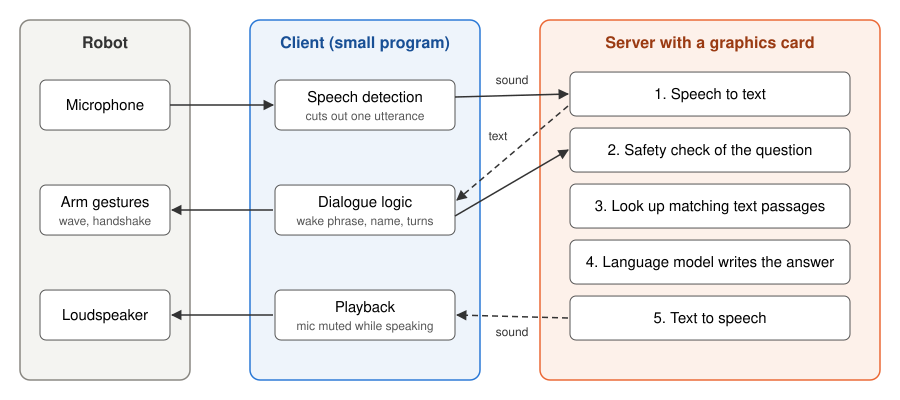

[Back to all setups](index.html)

# Voice: a humanoid that listens and answers

This page documents how a **Unitree G1** was set up to hold a short spoken conversation in German: it
wakes up when called by name, asks who it is talking to, waves, shakes hands, answers questions and
says goodbye. Nothing in it is one big "talking robot" program. It is a chain of five separate models,
each doing one small job, plus a little logic that holds them together.

The chain runs and has been shown to visitors. What is measured and what is not is listed at the end.

Last updated: 18 November 2026.

---

## What is a voice assistant made of?

Speaking with a machine feels like one thing. Inside, it is a relay race:

1. Notice that someone is speaking, and cut out what they said.
2. Turn the sound into text.
3. Decide what to answer, as text.
4. Turn the answer into sound.
5. Play it, without listening to yourself.

Each step is a different kind of model, and each can be swapped without touching the others.

### The building blocks

| Word | What it is | Here |
|---|---|---|
| **Sample rate** | How many times per second the sound wave is measured | 16,000 per second, one channel. Enough for speech |
| **Voice activity detection (VAD)** | Deciding where speech starts and ends in a stream of sound | By loudness, compared with the room's own noise |
| **Wake word** | The phrase that makes the assistant listen | "Hello" plus the robot's name |
| **Speech to text (ASR)** | A model that writes down what was said | Whisper large-v3-turbo |
| **Language model (LLM)** | A model that continues text: given the conversation so far, it writes the answer | Gemma 3 with 12 billion parameters, served by Ollama |
| **System prompt** | Fixed instructions the language model gets before every conversation: who it is, how to answer | A short text in German |
| **Retrieval (RAG)** | Looking up fitting passages in a text collection and handing them to the language model with the question | The two best passages from about 170 web pages |
| **Embedding model** | Turns a text into a list of numbers so that similar texts get similar numbers. Used to find the fitting passages | multilingual-e5-base |
| **Safety check** | A second model that judges whether a question or an answer is harmful | Nemotron Content Safety |
| **Text to speech (TTS)** | A model that reads text aloud | Piper, with a German voice |
| **Speaker recognition** | Telling who is speaking from the sound of the voice | Experimental, see step 8 |
| **Latency** | The wait between the end of the question and the start of the answer | 1.5 to 2 seconds |
| **Word error rate (WER)** | Of 100 spoken words, how many the speech-to-text model gets wrong | 5 in a quiet room |

### Who does what

Three parts, on up to three computers:

* **The robot** only has ears, a mouth and arms: microphone, loudspeaker, gestures.
* **The client** is a small program near the robot. It listens, cuts out utterances, keeps track of the
  conversation, plays the answer and triggers the gestures. It needs no graphics card.
* **The server** has a graphics card and keeps all models loaded. It offers three simple web addresses:
  one takes sound and returns text, one takes text and returns the answer, one takes text and returns sound.

Splitting it this way means the heavy models can move to a stronger computer without changing
anything on the robot.

---

## What we did, at a glance

| Step | Result |
|---|---|
| [1. Sound out](#1-getting-sound-out-of-the-robot) | The robot's own loudspeaker plays any sound we send |
| [2. Sound in](#2-getting-sound-into-the-computer) | A webcam microphone next to the robot, or the robot's own microphones |
| [3. Detecting speech and the wake phrase](#3-detecting-speech-and-the-wake-phrase) | Works without a separate wake-word model |
| [4. Speech to text](#4-speech-to-text) | Whisper; 5 % word errors in quiet, 25 % in loud noise |
| [5. The answer](#5-the-answer-language-model-retrieval-and-safety-check) | Language model with looked-up passages and a safety check |
| [6. Text to speech](#6-text-to-speech) | A German voice, a fifth of a second per answer |
| [7. Gestures](#7-gestures-a-wave-and-a-handshake) | Wave and handshake, with the handshake felt through the arm's motors |
| [8. Who is speaking](#8-who-is-speaking-experimental) | Experimental |

---

## Hardware and software

| Part | Details |
|---|---|
| Robot | Unitree G1 with its built-in loudspeaker and four-microphone array |
| Extra microphone | A webcam with a good microphone, placed next to the robot |
| Server | A PC with an NVIDIA graphics card |
| Models | Whisper large-v3-turbo, Gemma 3 12B (through Ollama), Piper, multilingual-e5-base, Nemotron Content Safety |

---

## 1. Getting sound out of the robot

The G1 has a loudspeaker and a service for playing sound through it (`AudioClient` in Unitree's SDK,
with `PlayStream` and `PlayStop`). The client sends the answer as raw sound, 16,000 samples per second.

This is the only part of the robot the conversation needs. The voice program uses nothing from the
walking or balance interface.

## 2. Getting sound into the computer

Two ways, both in use:

* **A webcam microphone next to the robot**, plugged into the computer that runs the client. Simple
  and clear, but the visitor has to stand near it.
* **The robot's own microphones.** The G1 sends what it hears onto its internal network as a plain
  stream (UDP multicast, address `239.168.123.161`, port `5555`, 16,000 samples per second). Any
  computer on the robot's wired network can listen in.

**Gotcha: the robot's microphone stream is off by default.** It only appears after the voice assistant
mode is switched on in Unitree's phone app. Until then the script waits and receives nothing.

**Gotcha: the robot hears itself.** The loudspeaker is as loud at the microphone as a person speaking.
Without care, the robot answers its own answer, forever. The fix: the microphone is ignored from the
moment playback starts until the robot reports that it has finished playing.

## 3. Detecting speech and the wake phrase

**Speech detection** is done by loudness. The program keeps measuring how loud the empty room is, and
treats anything clearly louder (three and a half times the room's level) as speech. An utterance ends
after 0.9 seconds of quiet, or after 10 seconds at the latest.

**The wake phrase** needs no model of its own. Every utterance goes to speech-to-text anyway, and the
program simply looks for "hello" plus the robot's name in the text. Since speech-to-text spells unusual
names in many ways, a list of common misspellings is accepted, and so is any word that is at least 75 %
similar to the name.

After the wake phrase the robot stays attentive for about 15 seconds after each answer, so follow-up
questions need no wake phrase. It forgets the visitor's name after three minutes.

**The trade-off:** this is simple and cheap to change, but every sound loud enough is sent to the
server, and the wake phrase can only be as good as speech-to-text is. A dedicated wake-word model
listens all the time at almost no cost and is the usual choice for a product.

## 4. Speech to text

**Whisper** (large-v3-turbo) runs on the graphics card and returns the text of one utterance in about a
third of a second.

How good is it? We tested with 150 German sentences from a public test set (FLEURS, 34 minutes), once
clean and twice with real room noise mixed in, recorded through the robot's own microphone.
"10 dB" means the speech is about three times louder than the noise, "5 dB" less than twice.

| Model | Quiet | Noise at 10 dB | Noise at 5 dB | Time per sentence |
|---|---|---|---|---|
| Whisper large-v3-turbo | 5.0 % | 11.5 % | 24.9 % | 0.33 s |
| Parakeet TDT 0.6B v3 | 5.0 % | 12.1 % | 21.5 % | 0.10 s |

(Word error rate: lower is better.)

The second model is three times faster and equally accurate on this test. We still stayed with Whisper:
on real German recordings from the robot's microphone, the other model answered with English text.
A test set is not the room.

**Gotcha: short questions get mangled.** A three-word question comes out wrong far more often than a
full sentence, because the model has little context to go on. Visitors are asked to speak in full sentences,
slowly, near the microphone.

**Gotcha: giving Whisper a vocabulary hint backfired.** Whisper accepts a hint text with words to
expect. With a hint containing our typical questions, it began to "hear" those questions in noise.
The hint was removed.

## 5. The answer: language model, retrieval and safety check

Three things happen to the question.

**Safety check.** A separate small model judges whether the question is harmful, and afterwards
whether the answer is. The check of the question runs while the language model is already writing, so
it costs little extra time. If either is judged harmful, the answer is thrown away and the robot gives
a fixed polite refusal.

**Retrieval.** A language model only knows what it was trained on, and it will happily invent facts
about a place it has never heard of. So before answering, the program looks up the two passages that
fit the question best in a collection of about 170 web pages, and hands them to the model together
with the question.

**Language model.** Gemma 3 (12 billion parameters) runs locally through **Ollama**, a program that
loads a language model and offers it as a local web service. A fixed system prompt tells it who it is
and how to answer: in German, in at most two sentences, without emojis or formatting.

| Stage | Time |
|---|---|
| Safety check | 0.2 to 0.6 s |
| Retrieval and language model | about 1 s |
| Text to speech | 0.2 s |
| **From the end of the question to the start of the answer** | **1.5 to 2 s** |

On a smaller computer the same chain took 2.5 to 3.4 seconds. Under two seconds feels like a slow
person; over three feels broken.

**Why keep the models loaded:** loading a model takes many seconds, answering takes one. The server
loads everything once at start and keeps it in memory.

## 6. Text to speech

**Piper** is a small, fast speech model that runs without a graphics card. It needs about a fifth of a
second for a short answer. The voice is a ready-made German one.

What makes a spoken answer sound right is decided earlier, in the system prompt: short sentences and
nothing that cannot be read aloud.

## 7. Gestures: a wave and a handshake

The G1 comes with ready-made arm motions. The conversation uses three: a wave, holding out the hand,
and lowering the arm again.

**The handshake is felt, not seen.** The robot holds out its hand and waits. The program watches the
forces in the motors of the right arm. A resting arm is very steady. A hand that grips and shakes it
makes the forces wobble about ten times as much. When the wobble starts and then stops, the handshake
is over and the arm is lowered. No camera and no touch sensor are needed.

**Safety habits for anything that moves the arm:**

* Gestures are off unless a marker file exists on the client computer. Deleting the file disables them
  at once, without stopping the conversation.
* The robot stands in free space, in its normal standing mode.
* One person holds the remote, with the stop command ready.

## 8. Who is speaking? (experimental)

Two more models can tell voices apart: one marks where different speakers talk in a recording, the
other turns a voice into a "voice print", a list of numbers that is similar for the same person. With
them the robot can notice that a second person has joined the conversation.

This works in first trials and takes 30 to 50 thousandths of a second per utterance. It was tuned on a
handful of sentences, and a voice print made from two short sentences is not reliable. A proper test
with several people at two distances is planned, not done.

---

## What is not measured, and what does not work yet

* **How well it understands through the robot's own microphone.** The error rates above are from clean
  test sentences with noise added. Real recordings from the robot have no written reference to compare with.
* **How reliable the wake phrase is:** how often it misses, and how often it wakes up by mistake.
* **Speaker recognition**, beyond first trials.
* **It only talks.** A spoken instruction does not make the robot walk or do a task. The conversation
  can trigger the two gestures and nothing else.

## Gotchas, in one place

| Problem | Cause | Fix |
|---|---|---|
| No sound from the robot's microphones | The stream is off by default | Switch on the voice assistant mode in the phone app |
| The robot answers itself | The loudspeaker is as loud as a person | Ignore the microphone until playback has finished |
| The wake phrase is missed | Speech-to-text spells the name differently each time | Accept misspellings and near matches |
| Short questions are misheard | Too little context for the model | Ask in full sentences |
| It "hears" questions in noise | A vocabulary hint biased the model | Remove the hint |
| A faster model answers in English | It was not robust to this microphone | Test on your own recordings, not only on a test set |
| Answers take three seconds | Models on too small a computer | Move the server to a stronger graphics card |
